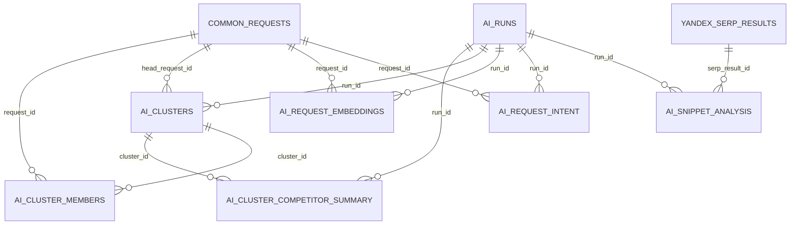

<!-- docs-db:generated -->
# AI и NLP

> Автоматически сгенерировано. Не редактировать вручную.

Таблиц: 7. Представлений: 3.

## Таблицы

### `ai.cluster_competitor_summary`

Описание не задано.

#### Колонки

| # | Колонка | Тип | Допустимость | Атрибуты | По умолчанию | Описание |
|---:|---|---|---|---|---|---|
| 1 | `cluster_id` | `integer` | NOT NULL | — | — | — |
| 2 | `summary` | `text` | NULL | — | — | — |
| 3 | `common_offers` | `jsonb` | NULL | — | — | — |
| 4 | `gaps` | `text` | NULL | — | — | — |
| 5 | `model` | `text` | NOT NULL | — | — | — |
| 6 | `run_id` | `integer` | NULL | — | — | — |
| 7 | `created_at` | `timestamp without time zone` | NOT NULL | — | `CURRENT_TIMESTAMP` | — |

#### Первичный ключ

`cluster_competitor_summary_pkey`: `cluster_id`

#### Внешние ключи

| Ограничение | Колонки | Ссылка | ON DELETE | ON UPDATE |
|---|---|---|---|---|
| `cluster_competitor_summary_cluster_id_fkey` | `cluster_id` | `ai.clusters` (`cluster_id`) | CASCADE | NO ACTION |
| `cluster_competitor_summary_run_id_fkey` | `run_id` | `ai.runs` (`run_id`) | NO ACTION | NO ACTION |

#### Индексы

| Имя | Тип | Уникальный | Колонки | Особенности |
|---|---|:---:|---|---|
| `cluster_competitor_summary_pkey` | `btree` | да | `cluster_id` | PRIMARY KEY |

### `ai.cluster_members`

Описание не задано.

#### Колонки

| # | Колонка | Тип | Допустимость | Атрибуты | По умолчанию | Описание |
|---:|---|---|---|---|---|---|
| 1 | `cluster_id` | `integer` | NOT NULL | — | — | — |
| 2 | `request_id` | `integer` | NOT NULL | — | — | — |
| 3 | `is_head` | `boolean` | NOT NULL | — | `false` | — |
| 4 | `assigned_by` | `text` | NOT NULL | — | — | — |
| 5 | `shared_urls` | `integer` | NULL | — | — | — |
| 6 | `similarity` | `real` | NULL | — | — | — |

#### Первичный ключ

`cluster_members_pkey`: `cluster_id`, `request_id`

#### Внешние ключи

| Ограничение | Колонки | Ссылка | ON DELETE | ON UPDATE |
|---|---|---|---|---|
| `cluster_members_cluster_id_fkey` | `cluster_id` | `ai.clusters` (`cluster_id`) | CASCADE | NO ACTION |
| `cluster_members_request_id_fkey` | `request_id` | `common.requests` (`request_id`) | CASCADE | NO ACTION |

#### CHECK-ограничения

- `cluster_members_assigned_by_check` — выражение скрыто до проверки.

#### Индексы

| Имя | Тип | Уникальный | Колонки | Особенности |
|---|---|:---:|---|---|
| `cluster_members_pkey` | `btree` | да | `cluster_id`, `request_id` | PRIMARY KEY |
| `idx_cluster_members_request` | `btree` | нет | `request_id` | — |

### `ai.clusters`

Описание не задано.

#### Колонки

| # | Колонка | Тип | Допустимость | Атрибуты | По умолчанию | Описание |
|---:|---|---|---|---|---|---|
| 1 | `cluster_id` | `integer` | NOT NULL | — | `nextval(…)` | — |
| 2 | `run_id` | `integer` | NOT NULL | — | — | — |
| 3 | `head_request_id` | `integer` | NULL | — | — | — |
| 4 | `label` | `text` | NULL | — | — | — |
| 5 | `size` | `integer` | NOT NULL | — | `0` | — |
| 6 | `created_at` | `timestamp without time zone` | NOT NULL | — | `CURRENT_TIMESTAMP` | — |

#### Первичный ключ

`clusters_pkey`: `cluster_id`

#### Внешние ключи

| Ограничение | Колонки | Ссылка | ON DELETE | ON UPDATE |
|---|---|---|---|---|
| `clusters_head_request_id_fkey` | `head_request_id` | `common.requests` (`request_id`) | SET NULL | NO ACTION |
| `clusters_run_id_fkey` | `run_id` | `ai.runs` (`run_id`) | CASCADE | NO ACTION |

#### Индексы

| Имя | Тип | Уникальный | Колонки | Особенности |
|---|---|:---:|---|---|
| `clusters_pkey` | `btree` | да | `cluster_id` | PRIMARY KEY |
| `idx_clusters_run` | `btree` | нет | `run_id` | — |

### `ai.request_embeddings`

Описание не задано.

#### Колонки

| # | Колонка | Тип | Допустимость | Атрибуты | По умолчанию | Описание |
|---:|---|---|---|---|---|---|
| 1 | `request_id` | `integer` | NOT NULL | — | — | — |
| 2 | `model` | `text` | NOT NULL | — | — | — |
| 3 | `dim` | `integer` | NOT NULL | — | — | — |
| 4 | `embedding` | `double precision[]` | NOT NULL | — | — | — |
| 5 | `run_id` | `integer` | NULL | — | — | — |
| 6 | `created_at` | `timestamp without time zone` | NOT NULL | — | `CURRENT_TIMESTAMP` | — |

#### Первичный ключ

`request_embeddings_pkey`: `request_id`, `model`

#### Внешние ключи

| Ограничение | Колонки | Ссылка | ON DELETE | ON UPDATE |
|---|---|---|---|---|
| `request_embeddings_request_id_fkey` | `request_id` | `common.requests` (`request_id`) | CASCADE | NO ACTION |
| `request_embeddings_run_id_fkey` | `run_id` | `ai.runs` (`run_id`) | NO ACTION | NO ACTION |

#### Индексы

| Имя | Тип | Уникальный | Колонки | Особенности |
|---|---|:---:|---|---|
| `request_embeddings_pkey` | `btree` | да | `request_id`, `model` | PRIMARY KEY |

### `ai.request_intent`

Описание не задано.

#### Колонки

| # | Колонка | Тип | Допустимость | Атрибуты | По умолчанию | Описание |
|---:|---|---|---|---|---|---|
| 1 | `request_id` | `integer` | NOT NULL | — | — | — |
| 2 | `intent` | `text` | NOT NULL | — | — | — |
| 3 | `product` | `text` | NOT NULL | — | — | — |
| 4 | `stage` | `text` | NULL | — | — | — |
| 5 | `confidence` | `numeric(3,2)` | NULL | — | — | — |
| 6 | `model` | `text` | NOT NULL | — | — | — |
| 7 | `run_id` | `integer` | NULL | — | — | — |
| 8 | `created_at` | `timestamp without time zone` | NOT NULL | — | `CURRENT_TIMESTAMP` | — |
| 9 | `updated_at` | `timestamp without time zone` | NOT NULL | — | `CURRENT_TIMESTAMP` | — |

#### Первичный ключ

`request_intent_pkey`: `request_id`

#### Внешние ключи

| Ограничение | Колонки | Ссылка | ON DELETE | ON UPDATE |
|---|---|---|---|---|
| `request_intent_request_id_fkey` | `request_id` | `common.requests` (`request_id`) | CASCADE | NO ACTION |
| `request_intent_run_id_fkey` | `run_id` | `ai.runs` (`run_id`) | NO ACTION | NO ACTION |

#### CHECK-ограничения

- `request_intent_intent_check` — выражение скрыто до проверки.
- `request_intent_product_check` — выражение скрыто до проверки.
- `request_intent_stage_check` — выражение скрыто до проверки.

#### Индексы

| Имя | Тип | Уникальный | Колонки | Особенности |
|---|---|:---:|---|---|
| `idx_request_intent_intent` | `btree` | нет | `intent` | — |
| `idx_request_intent_product` | `btree` | нет | `product` | — |
| `request_intent_pkey` | `btree` | да | `request_id` | PRIMARY KEY |

### `ai.runs`

Журнал технических запусков задач классификации, эмбеддингов, кластеризации и анализа сниппетов.

> Ограниченный режим: публикуются только структура и проверенные описания. Реальные значения и примеры запрещены.

#### Колонки

| # | Колонка | Тип | Допустимость | Атрибуты | По умолчанию | Описание |
|---:|---|---|---|---|---|---|
| 1 | `run_id` | `integer` | NOT NULL | — | `nextval(…)` | — |
| 2 | `task` | `text` | NOT NULL | — | — | — |
| 3 | `model` | `text` | NULL | — | — | — |
| 4 | `status` | `text` | NOT NULL | — | Есть; выражение скрыто до проверки | — |
| 5 | `params` | `jsonb` | NULL | — | — | Значения не публикуются. |
| 6 | `items_total` | `integer` | NOT NULL | — | `0` | Значения не публикуются. |
| 7 | `items_ok` | `integer` | NOT NULL | — | `0` | Значения не публикуются. |
| 8 | `items_failed` | `integer` | NOT NULL | — | `0` | Значения не публикуются. |
| 9 | `input_tokens` | `integer` | NOT NULL | — | `0` | Счётчик входных токенов модели; публикуются только имя и тип колонки, без значений. |
| 10 | `output_tokens` | `integer` | NOT NULL | — | `0` | Счётчик выходных токенов модели; публикуются только имя и тип колонки, без значений. |
| 11 | `est_cost_rub` | `numeric(10,2)` | NOT NULL | — | `0` | Оценка стоимости запуска; значения не публикуются. |
| 12 | `error` | `text` | NULL | — | — | Значения не публикуются. |
| 13 | `started_at` | `timestamp without time zone` | NOT NULL | — | `CURRENT_TIMESTAMP` | — |
| 14 | `finished_at` | `timestamp without time zone` | NULL | — | — | — |

#### Первичный ключ

`runs_pkey`: `run_id`

#### CHECK-ограничения

- `runs_status_check` — выражение скрыто до проверки.
- `runs_task_check` — выражение скрыто до проверки.

#### Индексы

| Имя | Тип | Уникальный | Колонки | Особенности |
|---|---|:---:|---|---|
| `runs_pkey` | `btree` | да | `run_id` | PRIMARY KEY |

### `ai.snippet_analysis`

Описание не задано.

#### Колонки

| # | Колонка | Тип | Допустимость | Атрибуты | По умолчанию | Описание |
|---:|---|---|---|---|---|---|
| 1 | `serp_result_id` | `integer` | NOT NULL | — | — | — |
| 2 | `page_type` | `text` | NULL | — | — | — |
| 3 | `offers` | `text[]` | NULL | — | — | — |
| 4 | `usp` | `text[]` | NULL | — | — | — |
| 5 | `features` | `jsonb` | NULL | — | — | — |
| 6 | `model` | `text` | NOT NULL | — | — | — |
| 7 | `run_id` | `integer` | NULL | — | — | — |
| 8 | `created_at` | `timestamp without time zone` | NOT NULL | — | `CURRENT_TIMESTAMP` | — |

#### Первичный ключ

`snippet_analysis_pkey`: `serp_result_id`

#### Внешние ключи

| Ограничение | Колонки | Ссылка | ON DELETE | ON UPDATE |
|---|---|---|---|---|
| `snippet_analysis_run_id_fkey` | `run_id` | `ai.runs` (`run_id`) | NO ACTION | NO ACTION |
| `snippet_analysis_serp_result_id_fkey` | `serp_result_id` | `yandex.serp_results` (`id`) | CASCADE | NO ACTION |

#### CHECK-ограничения

- `snippet_analysis_page_type_check` — выражение скрыто до проверки.

#### Индексы

| Имя | Тип | Уникальный | Колонки | Особенности |
|---|---|:---:|---|---|
| `idx_snippet_analysis_page_type` | `btree` | нет | `page_type` | — |
| `snippet_analysis_pkey` | `btree` | да | `serp_result_id` | PRIMARY KEY |

## Представления

### `ai.v_competitor_offers`

Описание не задано.

| # | Колонка | Тип | Описание |
|---:|---|---|---|
| 1 | `event_date` | `date` | — |
| 2 | `request` | `text` | — |
| 3 | `overall_position` | `integer` | — |
| 4 | `domain` | `text` | — |
| 5 | `is_own_domain` | `boolean` | — |
| 6 | `url` | `text` | — |
| 7 | `title` | `text` | — |
| 8 | `page_type` | `text` | — |
| 9 | `offers` | `text[]` | — |
| 10 | `usp` | `text[]` | — |
| 11 | `has_price` | `boolean` | — |
| 12 | `price_text` | `text` | — |
| 13 | `has_trial` | `boolean` | — |
| 14 | `has_sla` | `boolean` | — |
| 15 | `has_support_247` | `boolean` | — |
| 16 | `capacity` | `text` | — |

#### Зависимости

- `ai.snippet_analysis`
- `yandex.serp_results`

### `ai.v_request_classified`

Описание не задано.

| # | Колонка | Тип | Описание |
|---:|---|---|---|
| 1 | `request_id` | `integer` | — |
| 2 | `request` | `text` | — |
| 3 | `intent` | `text` | — |
| 4 | `product` | `text` | — |
| 5 | `stage` | `text` | — |
| 6 | `confidence` | `numeric(3,2)` | — |
| 7 | `model` | `text` | — |

#### Зависимости

- `ai.request_intent`
- `common.requests`

### `ai.v_request_clusters`

Описание не задано.

| # | Колонка | Тип | Описание |
|---:|---|---|---|
| 1 | `cluster_id` | `integer` | — |
| 2 | `cluster_label` | `text` | — |
| 3 | `cluster_size` | `integer` | — |
| 4 | `request_id` | `integer` | — |
| 5 | `request` | `text` | — |
| 6 | `is_head` | `boolean` | — |
| 7 | `assigned_by` | `text` | — |
| 8 | `shared_urls` | `integer` | — |
| 9 | `similarity` | `real` | — |
| 10 | `run_id` | `integer` | — |

#### Зависимости

- `ai.cluster_members`
- `ai.clusters`
- `ai.runs`
- `common.requests`

## Диаграмма физических связей

[Назад к навигации](index.md)
