<!-- docs-db:generated -->
# Общие справочники и семантическое ядро

> Автоматически сгенерировано. Не редактировать вручную.

Таблиц: 18. Представлений: 4.

## Таблицы

### `common.brand_keywords`

Описание не задано.

#### Колонки

| # | Колонка | Тип | Допустимость | Атрибуты | По умолчанию | Описание |
|---:|---|---|---|---|---|---|
| 1 | `id` | `smallint` | NOT NULL | — | `nextval(…)` | — |
| 2 | `keyword` | `text` | NOT NULL | — | — | — |
| 3 | `created_at` | `timestamp without time zone` | NULL | — | `now()` | — |

#### Первичный ключ

`brand_keywords_pkey`: `id`

#### Индексы

| Имя | Тип | Уникальный | Колонки | Особенности |
|---|---|:---:|---|---|
| `brand_keywords_pkey` | `btree` | да | `id` | PRIMARY KEY |

### `common.clusters`

Описание не задано.

#### Колонки

| # | Колонка | Тип | Допустимость | Атрибуты | По умолчанию | Описание |
|---:|---|---|---|---|---|---|
| 1 | `cluster_id` | `smallint` | NOT NULL | — | — | — |
| 2 | `cluster_name` | `text` | NULL | — | — | — |

#### Первичный ключ

`clusters_pk`: `cluster_id`

#### Индексы

| Имя | Тип | Уникальный | Колонки | Особенности |
|---|---|:---:|---|---|
| `clusters_pk` | `btree` | да | `cluster_id` | PRIMARY KEY |

### `common.clusters_topvisor`

Описание не задано.

#### Колонки

| # | Колонка | Тип | Допустимость | Атрибуты | По умолчанию | Описание |
|---:|---|---|---|---|---|---|
| 1 | `cluster_topvisor_id` | `smallint` | NOT NULL | — | `nextval(…)` | — |
| 2 | `cluster_topvisor_name` | `text` | NULL | — | — | — |
| 4 | `group_topvisor_id` | `integer` | NULL | — | — | — |
| 5 | `project_topvisor_id` | `integer` | NULL | — | — | — |

#### Первичный ключ

`clasters_pkey`: `cluster_topvisor_id`

#### Индексы

| Имя | Тип | Уникальный | Колонки | Особенности |
|---|---|:---:|---|---|
| `clasters_pkey` | `btree` | да | `cluster_topvisor_id` | PRIMARY KEY |

### `common.dim_projects_engines`

Описание не задано.

#### Колонки

| # | Колонка | Тип | Допустимость | Атрибуты | По умолчанию | Описание |
|---:|---|---|---|---|---|---|
| 1 | `id` | `integer` | NOT NULL | — | `nextval(…)` | — |
| 2 | `project_name` | `character varying(100)` | NOT NULL | — | — | — |
| 3 | `search_engine` | `character varying(50)` | NOT NULL | — | — | — |
| 4 | `created_at` | `timestamp without time zone` | NULL | — | `CURRENT_TIMESTAMP` | — |
| 5 | `topvisor_project_id` | `text` | NULL | — | — | — |
| 6 | `topvisor_region_id` | `text` | NULL | — | — | — |
| 7 | `name` | `text` | NULL | — | — | — |
| 8 | `url` | `text` | NULL | — | — | — |

#### Первичный ключ

`dim_projects_engines_pkey`: `id`

#### Уникальные ограничения

- `dim_projects_engines_project_name_search_engine_key`: `project_name`, `search_engine`

#### Индексы

| Имя | Тип | Уникальный | Колонки | Особенности |
|---|---|:---:|---|---|
| `dim_projects_engines_pkey` | `btree` | да | `id` | PRIMARY KEY |
| `dim_projects_engines_project_name_search_engine_key` | `btree` | да | `project_name`, `search_engine` | — |
| `idx_dim_projects_engines_engine` | `btree` | нет | `search_engine` | — |
| `idx_dim_projects_engines_name` | `btree` | нет | `project_name` | — |
| `idx_dim_projects_engines_name_engine` | `btree` | нет | `project_name`, `search_engine` | — |
| `idx_dim_projects_engines_topvisor` | `btree` | да | `topvisor_project_id`, `topvisor_region_id` | — |
| `idx_dim_projects_engines_topvisor_composite` | `btree` | нет | `topvisor_project_id`, `topvisor_region_id` | — |

### `common.google_alerts`

Описание не задано.

#### Колонки

| # | Колонка | Тип | Допустимость | Атрибуты | По умолчанию | Описание |
|---:|---|---|---|---|---|---|
| 1 | `id` | `integer` | NOT NULL | — | `nextval(…)` | — |
| 2 | `entry_id` | `text` | NOT NULL | — | — | — |
| 3 | `alert_name` | `text` | NOT NULL | — | — | — |
| 4 | `published_at` | `timestamp with time zone` | NOT NULL | — | — | — |
| 5 | `event_date` | `date` | NOT NULL | — | — | — |
| 6 | `domain` | `text` | NOT NULL | — | — | — |
| 7 | `url` | `text` | NOT NULL | — | — | — |
| 8 | `title` | `text` | NULL | — | — | — |
| 9 | `snippet` | `text` | NULL | — | — | — |
| 10 | `created_at` | `timestamp with time zone` | NOT NULL | — | `now()` | — |

#### Первичный ключ

`google_alerts_pkey`: `id`

#### Уникальные ограничения

- `google_alerts_entry_id_key`: `entry_id`

#### Индексы

| Имя | Тип | Уникальный | Колонки | Особенности |
|---|---|:---:|---|---|
| `google_alerts_entry_id_key` | `btree` | да | `entry_id` | — |
| `google_alerts_pkey` | `btree` | да | `id` | PRIMARY KEY |
| `google_alerts_url_uq` | `btree` | да | `url` | — |
| `idx_google_alerts_domain` | `btree` | нет | `domain` | — |
| `idx_google_alerts_event_date` | `btree` | нет | `event_date` | — |

### `common.google_updates`

Описание не задано.

#### Колонки

| # | Колонка | Тип | Допустимость | Атрибуты | По умолчанию | Описание |
|---:|---|---|---|---|---|---|
| 1 | `id` | `integer` | NOT NULL | — | `nextval(…)` | — |
| 2 | `incident_id` | `text` | NOT NULL | — | — | — |
| 3 | `title` | `text` | NOT NULL | — | — | — |
| 4 | `update_type` | `text` | NOT NULL | — | — | — |
| 5 | `service_name` | `text` | NULL | — | — | — |
| 6 | `severity` | `text` | NULL | — | — | — |
| 7 | `status_impact` | `text` | NULL | — | — | — |
| 8 | `begin_at` | `timestamp with time zone` | NOT NULL | — | — | — |
| 9 | `end_at` | `timestamp with time zone` | NULL | — | — | — |
| 10 | `begin_date` | `date` | NOT NULL | — | — | — |
| 11 | `end_date` | `date` | NULL | — | — | — |
| 12 | `modified_at` | `timestamp with time zone` | NULL | — | — | — |
| 13 | `description` | `text` | NULL | — | — | — |
| 14 | `url` | `text` | NULL | — | — | — |
| 15 | `created_at` | `timestamp with time zone` | NOT NULL | — | `now()` | — |
| 16 | `updated_at` | `timestamp with time zone` | NOT NULL | — | `now()` | — |

#### Первичный ключ

`google_updates_pkey`: `id`

#### Уникальные ограничения

- `google_updates_incident_id_key`: `incident_id`

#### Индексы

| Имя | Тип | Уникальный | Колонки | Особенности |
|---|---|:---:|---|---|
| `google_updates_incident_id_key` | `btree` | да | `incident_id` | — |
| `google_updates_pkey` | `btree` | да | `id` | PRIMARY KEY |
| `idx_google_updates_begin_date` | `btree` | нет | `begin_date` | — |

### `common.hubs`

Описание не задано.

#### Колонки

| # | Колонка | Тип | Допустимость | Атрибуты | По умолчанию | Описание |
|---:|---|---|---|---|---|---|
| 1 | `hub_id` | `smallint` | NOT NULL | — | `nextval(…)` | — |
| 2 | `hub_name` | `text` | NULL | — | — | — |

#### Первичный ключ

`hubs_pkey`: `hub_id`

#### Индексы

| Имя | Тип | Уникальный | Колонки | Особенности |
|---|---|:---:|---|---|
| `hubs_pkey` | `btree` | да | `hub_id` | PRIMARY KEY |

### `common.notes`

События с датой, категорией, заголовком и описанием.

> Ограниченный режим: публикуются только структура и проверенные описания. Реальные значения и примеры запрещены.

#### Колонки

| # | Колонка | Тип | Допустимость | Атрибуты | По умолчанию | Описание |
|---:|---|---|---|---|---|---|
| 1 | `id` | `integer` | NOT NULL | — | `nextval(…)` | — |
| 2 | `title` | `text` | NOT NULL | — | — | — |
| 3 | `description` | `text` | NULL | — | — | — |
| 4 | `event_date` | `date` | NOT NULL | — | — | Дата, к которой относится событие. |
| 5 | `category_id` | `integer` | NOT NULL | — | — | Идентификатор категории из common.notes_categories. |
| 6 | `created_at` | `timestamp without time zone` | NOT NULL | — | `CURRENT_TIMESTAMP` | — |
| 7 | `created_by` | `text` | NULL | — | — | Идентификатор чата Telegram; значения не публикуются. |

#### Первичный ключ

`notes_pkey`: `id`

#### Внешние ключи

| Ограничение | Колонки | Ссылка | ON DELETE | ON UPDATE |
|---|---|---|---|---|
| `notes_category_id_fkey` | `category_id` | `common.notes_categories` (`category_id`) | NO ACTION | NO ACTION |

#### Индексы

| Имя | Тип | Уникальный | Колонки | Особенности |
|---|---|:---:|---|---|
| `idx_notes_category` | `btree` | нет | `category_id` | — |
| `idx_notes_event_date` | `btree` | нет | `event_date` | — |
| `notes_pkey` | `btree` | да | `id` | PRIMARY KEY |

### `common.notes_categories`

Справочник категорий событий.

#### Колонки

| # | Колонка | Тип | Допустимость | Атрибуты | По умолчанию | Описание |
|---:|---|---|---|---|---|---|
| 1 | `category_id` | `integer` | NOT NULL | — | `nextval(…)` | — |
| 2 | `category_name` | `text` | NOT NULL | — | — | — |
| 3 | `icon` | `text` | NULL | — | — | — |

#### Первичный ключ

`notes_categories_pkey`: `category_id`

#### Уникальные ограничения

- `notes_categories_category_name_key`: `category_name`

#### Индексы

| Имя | Тип | Уникальный | Колонки | Особенности |
|---|---|:---:|---|---|
| `notes_categories_category_name_key` | `btree` | да | `category_name` | — |
| `notes_categories_pkey` | `btree` | да | `category_id` | PRIMARY KEY |

### `common.request_groups`

Описание не задано.

#### Колонки

| # | Колонка | Тип | Допустимость | Атрибуты | По умолчанию | Описание |
|---:|---|---|---|---|---|---|
| 1 | `group_id` | `integer` | NOT NULL | — | `nextval(…)` | — |
| 2 | `lemma_signature` | `text` | NOT NULL | — | — | — |
| 3 | `canonical_request` | `text` | NOT NULL | — | — | — |

#### Первичный ключ

`request_groups_pkey`: `group_id`

#### Уникальные ограничения

- `request_groups_lemma_signature_key`: `lemma_signature`

#### Индексы

| Имя | Тип | Уникальный | Колонки | Особенности |
|---|---|:---:|---|---|
| `request_groups_lemma_signature_key` | `btree` | да | `lemma_signature` | — |
| `request_groups_pkey` | `btree` | да | `group_id` | PRIMARY KEY |

### `common.request_urls`

Связь поисковых запросов с URL-адресами.

#### Колонки

| # | Колонка | Тип | Допустимость | Атрибуты | По умолчанию | Описание |
|---:|---|---|---|---|---|---|
| 1 | `request_id` | `integer` | NOT NULL | — | — | — |
| 2 | `site_map_id` | `integer` | NOT NULL | — | — | — |
| 3 | `created_at` | `timestamp without time zone` | NULL | — | `CURRENT_TIMESTAMP` | — |

#### Первичный ключ

`request_urls_pkey`: `request_id`, `site_map_id`

#### Внешние ключи

| Ограничение | Колонки | Ссылка | ON DELETE | ON UPDATE |
|---|---|---|---|---|
| `request_urls_request_id_fkey` | `request_id` | `common.requests` (`request_id`) | NO ACTION | NO ACTION |
| `request_urls_site_map_id_fkey` | `site_map_id` | `common.site_map` (`id`) | NO ACTION | NO ACTION |

#### Индексы

| Имя | Тип | Уникальный | Колонки | Особенности |
|---|---|:---:|---|---|
| `idx_request_urls_site_map` | `btree` | нет | `site_map_id` | — |
| `request_urls_pkey` | `btree` | да | `request_id`, `site_map_id` | PRIMARY KEY |

### `common.request_words`

Описание не задано.

#### Колонки

| # | Колонка | Тип | Допустимость | Атрибуты | По умолчанию | Описание |
|---:|---|---|---|---|---|---|
| 1 | `word_id` | `integer` | NOT NULL | — | `nextval(…)` | — |
| 2 | `word` | `text` | NOT NULL | — | — | — |
| 3 | `lemma` | `text` | NOT NULL | — | — | — |

#### Первичный ключ

`request_words_pkey`: `word_id`

#### Уникальные ограничения

- `request_words_word_key`: `word`

#### Индексы

| Имя | Тип | Уникальный | Колонки | Особенности |
|---|---|:---:|---|---|
| `idx_request_words_lemma` | `btree` | нет | `lemma` | — |
| `request_words_pkey` | `btree` | да | `word_id` | PRIMARY KEY |
| `request_words_word_key` | `btree` | да | `word` | — |

### `common.requests`

Справочник поисковых запросов и их классификации.

> Ограниченный режим: публикуются только структура и проверенные описания. Реальные значения и примеры запрещены.

#### Колонки

| # | Колонка | Тип | Допустимость | Атрибуты | По умолчанию | Описание |
|---:|---|---|---|---|---|---|
| 1 | `request` | `text` | NULL | — | — | — |
| 2 | `cluster_topvisor_id` | `smallint` | NULL | — | — | — |
| 5 | `request_id` | `integer` | NOT NULL | — | `nextval(…)` | — |
| 6 | `hub_id` | `smallint` | NULL | — | — | — |
| 7 | `type_request_id` | `smallint` | NULL | — | — | — |
| 8 | `cluster_id` | `smallint` | NULL | — | — | — |
| 9 | `topic_id` | `integer` | NULL | — | — | — |
| 10 | `created_at` | `timestamp without time zone` | NULL | — | `CURRENT_TIMESTAMP` | — |
| 11 | `updated_at` | `timestamp without time zone` | NULL | — | `CURRENT_TIMESTAMP` | — |
| 12 | `group_id` | `integer` | NULL | — | — | — |

#### Первичный ключ

`requests_pkey`: `request_id`

#### Внешние ключи

| Ограничение | Колонки | Ссылка | ON DELETE | ON UPDATE |
|---|---|---|---|---|
| `fk_cluster_topvisor` | `cluster_topvisor_id` | `common.clusters_topvisor` (`cluster_topvisor_id`) | NO ACTION | NO ACTION |
| `fk_hub` | `hub_id` | `common.hubs` (`hub_id`) | NO ACTION | NO ACTION |
| `fk_requests_clusters` | `cluster_id` | `common.clusters` (`cluster_id`) | NO ACTION | NO ACTION |
| `fk_type_request` | `type_request_id` | `common.type_request` (`type_request_id`) | NO ACTION | NO ACTION |
| `requests_group_id_fkey` | `group_id` | `common.request_groups` (`group_id`) | NO ACTION | NO ACTION |
| `requests_topic_id_fkey` | `topic_id` | `common.topics` (`topic_id`) | NO ACTION | NO ACTION |

#### Уникальные ограничения

- `requests_request_key`: `request`

#### Индексы

| Имя | Тип | Уникальный | Колонки | Особенности |
|---|---|:---:|---|---|
| `idx_requests_cluster` | `btree` | нет | `cluster_topvisor_id` | — |
| `idx_requests_group` | `btree` | нет | `group_id` | — |
| `idx_requests_hub` | `btree` | нет | `hub_id` | — |
| `idx_requests_request` | `btree` | нет | `request` | — |
| `idx_requests_request_id` | `btree` | нет | `request_id` | — |
| `requests_pkey` | `btree` | да | `request_id` | PRIMARY KEY |
| `requests_request_key` | `btree` | да | `request` | — |

### `common.requests_words`

Описание не задано.

#### Колонки

| # | Колонка | Тип | Допустимость | Атрибуты | По умолчанию | Описание |
|---:|---|---|---|---|---|---|
| 1 | `request_id` | `integer` | NOT NULL | — | — | — |
| 2 | `word_id` | `integer` | NOT NULL | — | — | — |

#### Первичный ключ

`requests_words_pkey`: `request_id`, `word_id`

#### Внешние ключи

| Ограничение | Колонки | Ссылка | ON DELETE | ON UPDATE |
|---|---|---|---|---|
| `requests_words_request_id_fkey` | `request_id` | `common.requests` (`request_id`) | CASCADE | NO ACTION |
| `requests_words_word_id_fkey` | `word_id` | `common.request_words` (`word_id`) | CASCADE | NO ACTION |

#### Индексы

| Имя | Тип | Уникальный | Колонки | Особенности |
|---|---|:---:|---|---|
| `idx_requests_words_word` | `btree` | нет | `word_id` | — |
| `requests_words_pkey` | `btree` | да | `request_id`, `word_id` | PRIMARY KEY |

### `common.site_map`

Справочник URL-адресов, используемый для нормализации страниц.

#### Колонки

| # | Колонка | Тип | Допустимость | Атрибуты | По умолчанию | Описание |
|---:|---|---|---|---|---|---|
| 1 | `id` | `integer` | NOT NULL | — | `nextval(…)` | — |
| 2 | `url` | `text` | NOT NULL | — | — | — |
| 3 | `created_at` | `timestamp without time zone` | NULL | — | `CURRENT_TIMESTAMP` | — |

#### Первичный ключ

`site_map_clean_pkey`: `id`

#### Уникальные ограничения

- `site_map_clean_url_key`: `url`

#### Индексы

| Имя | Тип | Уникальный | Колонки | Особенности |
|---|---|:---:|---|---|
| `idx_site_map_url` | `btree` | нет | `url` | — |
| `site_map_clean_pkey` | `btree` | да | `id` | PRIMARY KEY |
| `site_map_clean_url_key` | `btree` | да | `url` | — |

### `common.topics`

Описание не задано.

#### Колонки

| # | Колонка | Тип | Допустимость | Атрибуты | По умолчанию | Описание |
|---:|---|---|---|---|---|---|
| 1 | `topic_id` | `integer` | NOT NULL | — | `nextval(…)` | — |
| 2 | `topic_name` | `text` | NOT NULL | — | — | — |

#### Первичный ключ

`topics_pkey`: `topic_id`

#### Уникальные ограничения

- `topics_topic_name_key`: `topic_name`

#### Индексы

| Имя | Тип | Уникальный | Колонки | Особенности |
|---|---|:---:|---|---|
| `topics_pkey` | `btree` | да | `topic_id` | PRIMARY KEY |
| `topics_topic_name_key` | `btree` | да | `topic_name` | — |

### `common.type_request`

Описание не задано.

#### Колонки

| # | Колонка | Тип | Допустимость | Атрибуты | По умолчанию | Описание |
|---:|---|---|---|---|---|---|
| 1 | `type_request_id` | `smallint` | NOT NULL | — | `nextval(…)` | — |
| 2 | `name_type` | `text` | NULL | — | — | — |

#### Уникальные ограничения

- `type_request_type_request_id_key`: `type_request_id`

#### Индексы

| Имя | Тип | Уникальный | Колонки | Особенности |
|---|---|:---:|---|---|
| `type_request_type_request_id_key` | `btree` | да | `type_request_id` | — |

### `common.wordstat_phrases`

Описание не задано.

#### Колонки

| # | Колонка | Тип | Допустимость | Атрибуты | По умолчанию | Описание |
|---:|---|---|---|---|---|---|
| 1 | `id` | `integer` | NOT NULL | — | `nextval(…)` | — |
| 2 | `phrase` | `text` | NOT NULL | — | — | — |

#### Первичный ключ

`wordstat_phrases_pkey`: `id`

#### Уникальные ограничения

- `wordstat_phrases_phrase_key`: `phrase`

#### Индексы

| Имя | Тип | Уникальный | Колонки | Особенности |
|---|---|:---:|---|---|
| `wordstat_phrases_phrase_key` | `btree` | да | `phrase` | — |
| `wordstat_phrases_pkey` | `btree` | да | `id` | PRIMARY KEY |

## Представления

### `common.v_cluster_groups`

Описание не задано.

| # | Колонка | Тип | Описание |
|---:|---|---|---|
| 1 | `group_id` | `smallint` | — |
| 2 | `group_name` | `text` | — |
| 3 | `project_name` | `character varying(100)` | — |

#### Зависимости

- `common.clusters_topvisor`
- `common.dim_projects_engines`

### `common.v_notes`

Описание не задано.

| # | Колонка | Тип | Описание |
|---:|---|---|---|
| 1 | `id` | `integer` | — |
| 2 | `title` | `text` | — |
| 3 | `description` | `text` | — |
| 4 | `event_date` | `date` | — |
| 5 | `category_name` | `text` | — |
| 6 | `icon` | `text` | — |
| 7 | `created_at` | `timestamp without time zone` | — |

#### Зависимости

- `common.notes`
- `common.notes_categories`

### `common.v_request_groups`

Описание не задано.

| # | Колонка | Тип | Описание |
|---:|---|---|---|
| 1 | `group_id` | `integer` | — |
| 2 | `canonical_request` | `text` | — |
| 3 | `lemma_signature` | `text` | — |
| 4 | `variants_count` | `bigint` | — |
| 5 | `variants` | `text` | — |

#### Зависимости

- `common.request_groups`
- `common.requests`

### `common.v_requests_lemmatized`

Описание не задано.

| # | Колонка | Тип | Описание |
|---:|---|---|---|
| 1 | `request_id` | `integer` | — |
| 2 | `request` | `text` | — |
| 3 | `lemmas` | `text` | — |

#### Зависимости

- `common.request_words`
- `common.requests`
- `common.requests_words`

## Диаграмма физических связей

```mermaid
erDiagram
  COMMON_REQUESTS ||--o{ AI_CLUSTER_MEMBERS : "request_id"
  COMMON_REQUESTS ||--o{ AI_CLUSTERS : "head_request_id"
  COMMON_REQUESTS ||--o{ AI_REQUEST_EMBEDDINGS : "request_id"
  COMMON_REQUESTS ||--o{ AI_REQUEST_INTENT : "request_id"
  COMMON_NOTES_CATEGORIES ||--o{ COMMON_NOTES : "category_id"
  COMMON_REQUESTS ||--o{ COMMON_REQUEST_URLS : "request_id"
  COMMON_SITE_MAP ||--o{ COMMON_REQUEST_URLS : "site_map_id"
  COMMON_REQUESTS ||--o{ COMMON_REQUESTS_WORDS : "request_id"
  COMMON_REQUEST_WORDS ||--o{ COMMON_REQUESTS_WORDS : "word_id"
  COMMON_CLUSTERS_TOPVISOR ||--o{ COMMON_REQUESTS : "cluster_topvisor_id"
  COMMON_HUBS ||--o{ COMMON_REQUESTS : "hub_id"
  COMMON_CLUSTERS ||--o{ COMMON_REQUESTS : "cluster_id"
  COMMON_TYPE_REQUEST ||--o{ COMMON_REQUESTS : "type_request_id"
  COMMON_REQUEST_GROUPS ||--o{ COMMON_REQUESTS : "group_id"
  COMMON_TOPICS ||--o{ COMMON_REQUESTS : "topic_id"
  COMMON_SITE_MAP ||--o{ GA4_WEB_VITALS : "target_url"
  COMMON_REQUEST_GROUPS ||--o{ GSC_TOP_QUERIES_BY_PAGE : "group_id"
  COMMON_REQUESTS ||--o{ REPORTS_DEMAND_PHRASES : "request_id"
  COMMON_REQUESTS ||--o{ TOPVISOR_POSITIONS : "request_id"
  COMMON_DIM_PROJECTS_ENGINES ||--o{ TOPVISOR_POSITIONS : "project_engine_id"
  COMMON_SITE_MAP ||--o{ TOPVISOR_POSITIONS : "relevant_url_id"
  COMMON_REQUESTS ||--o{ WORDSTAT_CHECK_LIST : "request_id"
  COMMON_REQUESTS ||--o{ WORDSTAT_DYNAMICS_RANGE_DAILY : "request_id"
  COMMON_REQUESTS ||--o{ WORDSTAT_DYNAMICS_RANGE : "request_id"
  COMMON_WORDSTAT_PHRASES ||--o{ WORDSTAT_TOP_REQUESTS : "base_phrase_id"
  COMMON_WORDSTAT_PHRASES ||--o{ WORDSTAT_TOP_REQUESTS : "related_phrase_id"
  COMMON_SITE_MAP ||--o{ YANDEX_SERP_RESULTS : "target_url_id"
```

[Назад к навигации](index.md)
