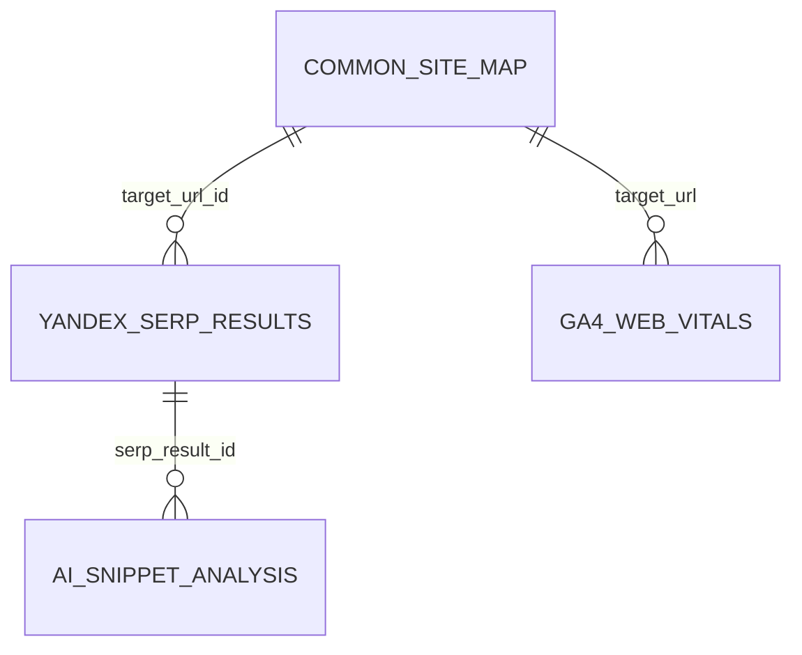

<!-- docs-db:generated -->
# Интеграции и внешние данные

> Автоматически сгенерировано. Не редактировать вручную.

Таблиц: 5. Представлений: 1.

## Таблицы

### `ga4.web_vitals`

Агрегированные метрики Core Web Vitals из GA4.

#### Колонки

| # | Колонка | Тип | Допустимость | Атрибуты | По умолчанию | Описание |
|---:|---|---|---|---|---|---|
| 1 | `event_date` | `date` | NOT NULL | — | — | — |
| 2 | `metric_name` | `text` | NOT NULL | — | — | — |
| 4 | `event_count` | `integer` | NULL | — | `0` | — |
| 6 | `metric_value` | `double precision` | NULL | — | `0` | — |
| 7 | `created_at` | `timestamp without time zone` | NULL | — | `CURRENT_TIMESTAMP` | — |
| 8 | `updated_at` | `timestamp without time zone` | NULL | — | `CURRENT_TIMESTAMP` | — |
| 9 | `target_url` | `integer` | NOT NULL | — | — | — |

#### Первичный ключ

`web_vitals_pkey`: `event_date`, `metric_name`, `target_url`

#### Внешние ключи

| Ограничение | Колонки | Ссылка | ON DELETE | ON UPDATE |
|---|---|---|---|---|
| `web_vitals_target_url_fkey` | `target_url` | `common.site_map` (`id`) | NO ACTION | NO ACTION |

#### Индексы

| Имя | Тип | Уникальный | Колонки | Особенности |
|---|---|:---:|---|---|
| `idx_web_vitals_date` | `btree` | нет | `event_date` | — |
| `idx_web_vitals_metric` | `btree` | нет | `metric_name` | — |
| `idx_web_vitals_target_url` | `btree` | нет | `target_url` | — |
| `web_vitals_pkey` | `btree` | да | `event_date`, `metric_name`, `target_url` | PRIMARY KEY |

### `l7.checkhost_scan`

Результаты сетевых проверок доменов.

> Ограниченный режим: публикуются только структура и проверенные описания. Реальные значения и примеры запрещены.

#### Колонки

| # | Колонка | Тип | Допустимость | Атрибуты | По умолчанию | Описание |
|---:|---|---|---|---|---|---|
| 1 | `id` | `integer` | NOT NULL | — | `nextval(…)` | — |
| 2 | `client_id` | `bigint` | NULL | — | — | Внутренний идентификатор клиента; значения не публикуются. |
| 3 | `domain` | `text` | NOT NULL | — | — | Значения не публикуются. |
| 4 | `checked_at` | `timestamp without time zone` | NOT NULL | — | `CURRENT_TIMESTAMP` | — |
| 5 | `request_id` | `text` | NULL | — | — | Значения не публикуются. |
| 6 | `resolved_ips` | `jsonb` | NULL | — | — | Значения не публикуются. |
| 7 | `ip` | `text` | NULL | — | — | IP-адрес; значения не публикуются. |
| 8 | `country` | `text` | NULL | — | — | Значения не публикуются. |
| 9 | `region` | `text` | NULL | — | — | Значения не публикуются. |
| 10 | `city` | `text` | NULL | — | — | Значения не публикуются. |
| 11 | `isp` | `text` | NULL | — | — | Значения не публикуются. |
| 12 | `org` | `text` | NULL | — | — | Значения не публикуются. |
| 13 | `as_number` | `text` | NULL | — | — | Значения не публикуются. |
| 14 | `as_name` | `text` | NULL | — | — | Значения не публикуются. |
| 15 | `dns_success` | `boolean` | NOT NULL | — | `false` | — |
| 16 | `geoip_success` | `boolean` | NOT NULL | — | `false` | — |
| 17 | `error_message` | `text` | NULL | — | — | — |

#### Первичный ключ

`checkhost_scan_pkey`: `id`

#### Индексы

| Имя | Тип | Уникальный | Колонки | Особенности |
|---|---|:---:|---|---|
| `checkhost_scan_pkey` | `btree` | да | `id` | PRIMARY KEY |
| `idx_checkhost_scan_checked_at` | `btree` | нет | `checked_at` | — |
| `idx_checkhost_scan_domain_unique` | `btree` | да | `domain` | — |
| `idx_checkhost_scan_ip` | `btree` | нет | `ip` | — |

### `l7.clients`

Справочник доменов клиентов.

> Ограниченный режим: публикуются только структура и проверенные описания. Реальные значения и примеры запрещены.

#### Колонки

| # | Колонка | Тип | Допустимость | Атрибуты | По умолчанию | Описание |
|---:|---|---|---|---|---|---|
| 1 | `domain` | `text` | NOT NULL | — | — | Доменное имя; значения не публикуются. |
| 3 | `id` | `bigint` | NOT NULL | — | `nextval(…)` | Значения не публикуются. |
| 4 | `clean_domain` | `text` | NULL | — | — | Значения не публикуются. |
| 5 | `is_ip` | `boolean` | NULL | — | — | — |
| 6 | `has_digits` | `boolean` | NULL | — | — | — |
| 7 | `is_forbidden` | `boolean` | NULL | — | — | — |

#### Первичный ключ

`clients_pkey`: `domain`

#### Индексы

| Имя | Тип | Уникальный | Колонки | Особенности |
|---|---|:---:|---|---|
| `clients_pkey` | `btree` | да | `domain` | PRIMARY KEY |

### `l7.domains_meta_scan`

Результаты сбора метаданных страниц доменов.

> Ограниченный режим: публикуются только структура и проверенные описания. Реальные значения и примеры запрещены.

#### Колонки

| # | Колонка | Тип | Допустимость | Атрибуты | По умолчанию | Описание |
|---:|---|---|---|---|---|---|
| 1 | `id` | `integer` | NOT NULL | — | `nextval(…)` | — |
| 2 | `client_id` | `bigint` | NULL | — | — | Значения не публикуются. |
| 3 | `domain` | `text` | NOT NULL | — | — | Доменное имя; значения не публикуются. |
| 4 | `scanned_at` | `timestamp without time zone` | NOT NULL | — | `CURRENT_TIMESTAMP` | — |
| 5 | `status_code` | `integer` | NULL | — | — | — |
| 6 | `had_redirect` | `boolean` | NOT NULL | — | `false` | — |
| 7 | `redirect_status` | `text` | NULL | — | — | — |
| 8 | `final_url` | `text` | NULL | — | — | Значения не публикуются. |
| 9 | `title` | `text` | NULL | — | — | Значения не публикуются. |
| 10 | `description` | `text` | NULL | — | — | Значения не публикуются. |
| 11 | `keywords` | `text` | NULL | — | — | Значения не публикуются. |
| 12 | `h1` | `text` | NULL | — | — | Значения не публикуются. |
| 13 | `og_title` | `text` | NULL | — | — | Значения не публикуются. |
| 14 | `og_image` | `text` | NULL | — | — | Значения не публикуются. |
| 15 | `canonical` | `text` | NULL | — | — | Значения не публикуются. |
| 16 | `robots` | `text` | NULL | — | — | Значения не публикуются. |
| 17 | `viewport` | `text` | NULL | — | — | — |
| 18 | `charset` | `text` | NULL | — | — | — |
| 19 | `is_captcha` | `boolean` | NOT NULL | — | `false` | — |
| 20 | `success` | `boolean` | NOT NULL | — | `false` | — |
| 21 | `error_message` | `text` | NULL | — | — | — |
| 22 | `site_type` | `text` | NULL | — | — | — |

#### Первичный ключ

`domains_meta_scan_pkey`: `id`

#### Индексы

| Имя | Тип | Уникальный | Колонки | Особенности |
|---|---|:---:|---|---|
| `domains_meta_scan_pkey` | `btree` | да | `id` | PRIMARY KEY |
| `idx_domains_meta_scan_captcha` | `btree` | нет | `is_captcha` | частичный; WHERE скрыт до проверки |
| `idx_domains_meta_scan_domain` | `btree` | нет | `domain` | — |
| `idx_domains_meta_scan_scanned_at` | `btree` | нет | `scanned_at` | — |

### `yandex.serp_results`

Результаты поисковой выдачи Яндекса по запросам и датам сбора.

#### Колонки

| # | Колонка | Тип | Допустимость | Атрибуты | По умолчанию | Описание |
|---:|---|---|---|---|---|---|
| 1 | `id` | `integer` | NOT NULL | — | `nextval(…)` | — |
| 2 | `event_date` | `date` | NOT NULL | — | — | — |
| 3 | `request` | `text` | NOT NULL | — | — | — |
| 4 | `search_type` | `text` | NOT NULL | — | Есть; выражение скрыто до проверки | — |
| 5 | `overall_position` | `integer` | NOT NULL | — | — | — |
| 6 | `group_position` | `integer` | NULL | — | — | — |
| 7 | `doc_position_in_group` | `integer` | NULL | — | — | — |
| 8 | `domain` | `text` | NULL | — | — | — |
| 9 | `url` | `text` | NOT NULL | — | — | — |
| 10 | `title` | `text` | NULL | — | — | — |
| 11 | `snippet` | `text` | NULL | — | — | — |
| 12 | `target_url_id` | `integer` | NULL | — | — | — |
| 13 | `is_own_domain` | `boolean` | NOT NULL | — | `false` | — |
| 14 | `created_at` | `timestamp without time zone` | NULL | — | `CURRENT_TIMESTAMP` | — |

#### Первичный ключ

`serp_results_pkey`: `id`

#### Внешние ключи

| Ограничение | Колонки | Ссылка | ON DELETE | ON UPDATE |
|---|---|---|---|---|
| `serp_results_target_url_id_fkey` | `target_url_id` | `common.site_map` (`id`) | NO ACTION | NO ACTION |

#### Уникальные ограничения

- `serp_results_event_date_request_search_type_url_key`: `event_date`, `request`, `search_type`, `url`

#### Индексы

| Имя | Тип | Уникальный | Колонки | Особенности |
|---|---|:---:|---|---|
| `idx_serp_results_date_request` | `btree` | нет | `event_date`, `request` | — |
| `idx_serp_results_domain` | `btree` | нет | `domain` | — |
| `idx_serp_results_own_domain` | `btree` | нет | `is_own_domain` | частичный; WHERE скрыт до проверки |
| `serp_results_event_date_request_search_type_url_key` | `btree` | да | `event_date`, `request`, `search_type`, `url` | — |
| `serp_results_pkey` | `btree` | да | `id` | PRIMARY KEY |

## Представления

### `yandex.serp_results_dynamics`

Описание не задано.

| # | Колонка | Тип | Описание |
|---:|---|---|---|
| 1 | `event_date` | `date` | — |
| 2 | `request` | `text` | — |
| 3 | `overall_position` | `integer` | — |
| 4 | `url` | `text` | — |
| 5 | `domain` | `text` | — |
| 6 | `title` | `text` | — |
| 7 | `snippet` | `text` | — |
| 8 | `is_own_domain` | `integer` | — |
| 9 | `prev_position` | `integer` | — |
| 10 | `position_delta` | `integer` | — |
| 11 | `title_changed` | `integer` | — |
| 12 | `snippet_changed` | `integer` | — |
| 13 | `project_name` | `character varying(100)` | — |
| 14 | `cluster_topvisor_name` | `text` | — |

#### Зависимости

- `common.dim_projects_engines`
- `topvisor.dim_groups`
- `topvisor.dim_keywords`
- `topvisor.dim_projects`
- `yandex.serp_results`

## Диаграмма физических связей

[Назад к навигации](index.md)
