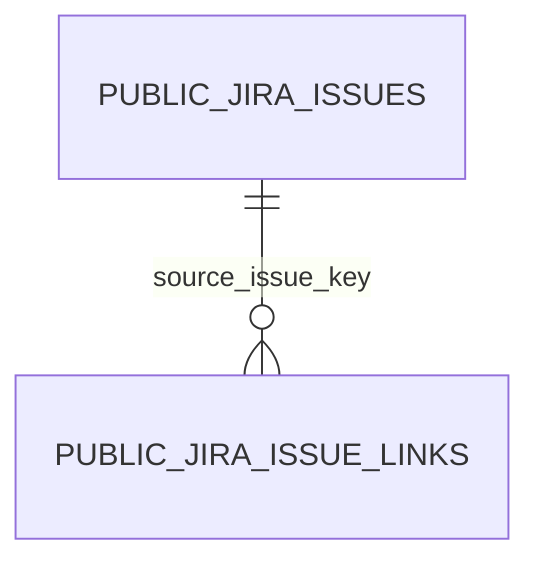

<!-- docs-db:generated -->
# Разрешённые таблицы схемы public

> Автоматически сгенерировано. Не редактировать вручную.

Таблиц: 3. Представлений: 0.

## Таблицы

### `public.jira_issue_links`

Описание не задано.

#### Колонки

| # | Колонка | Тип | Допустимость | Атрибуты | По умолчанию | Описание |
|---:|---|---|---|---|---|---|
| 1 | `id` | `integer` | NOT NULL | — | `nextval(…)` | — |
| 2 | `source_issue_key` | `character varying(50)` | NOT NULL | — | — | — |
| 3 | `target_issue_key` | `character varying(50)` | NOT NULL | — | — | — |
| 4 | `link_type` | `character varying(100)` | NULL | — | — | — |
| 5 | `link_type_name` | `character varying(200)` | NULL | — | — | — |
| 6 | `direction` | `character varying(20)` | NULL | — | — | — |
| 7 | `direction_label` | `character varying(100)` | NULL | — | — | — |
| 8 | `target_summary` | `text` | NULL | — | — | — |
| 9 | `target_status` | `character varying(100)` | NULL | — | — | — |
| 10 | `target_priority` | `character varying(50)` | NULL | — | — | — |
| 11 | `created_at` | `timestamp without time zone` | NULL | — | `CURRENT_TIMESTAMP` | — |

#### Первичный ключ

`jira_issue_links_pkey`: `id`

#### Внешние ключи

| Ограничение | Колонки | Ссылка | ON DELETE | ON UPDATE |
|---|---|---|---|---|
| `jira_issue_links_source_issue_key_fkey` | `source_issue_key` | `public.jira_issues` (`issue_key`) | CASCADE | NO ACTION |

#### Индексы

| Имя | Тип | Уникальный | Колонки | Особенности |
|---|---|:---:|---|---|
| `idx_both_issues` | `btree` | нет | `source_issue_key`, `target_issue_key` | — |
| `idx_link_type` | `btree` | нет | `link_type` | — |
| `idx_source_issue` | `btree` | нет | `source_issue_key` | — |
| `idx_target_issue` | `btree` | нет | `target_issue_key` | — |
| `jira_issue_links_pkey` | `btree` | да | `id` | PRIMARY KEY |

### `public.jira_issues`

Описание не задано.

#### Колонки

| # | Колонка | Тип | Допустимость | Атрибуты | По умолчанию | Описание |
|---:|---|---|---|---|---|---|
| 1 | `id` | `integer` | NOT NULL | — | `nextval(…)` | — |
| 2 | `issue_key` | `character varying(50)` | NOT NULL | — | — | — |
| 3 | `issue_type` | `character varying(100)` | NULL | — | — | — |
| 4 | `status` | `character varying(100)` | NULL | — | — | — |
| 5 | `created_date` | `timestamp without time zone` | NULL | — | — | — |
| 6 | `time_original_estimate` | `numeric(10,2)` | NULL | — | — | — |
| 7 | `time_spent` | `numeric(10,2)` | NULL | — | — | — |
| 8 | `updated_date` | `timestamp without time zone` | NULL | — | — | — |
| 9 | `sprint` | `character varying(500)` | NULL | — | — | — |
| 10 | `epic_link` | `character varying(50)` | NULL | — | — | — |
| 11 | `summary` | `text` | NULL | — | — | — |
| 12 | `assignee` | `character varying(255)` | NULL | — | — | — |
| 13 | `reporter` | `character varying(255)` | NULL | — | — | — |
| 14 | `priority` | `character varying(50)` | NULL | — | — | — |
| 15 | `labels` | `text[]` | NULL | — | — | — |
| 16 | `linked_issues` | `text[]` | NULL | — | — | — |
| 17 | `last_synced` | `timestamp without time zone` | NULL | — | `CURRENT_TIMESTAMP` | — |

#### Первичный ключ

`jira_issues_pkey`: `id`

#### Уникальные ограничения

- `jira_issues_issue_key_key`: `issue_key`

#### Индексы

| Имя | Тип | Уникальный | Колонки | Особенности |
|---|---|:---:|---|---|
| `idx_assignee` | `btree` | нет | `assignee` | — |
| `idx_created_date` | `btree` | нет | `created_date` | — |
| `idx_epic_link` | `btree` | нет | `epic_link` | — |
| `idx_issue_key` | `btree` | нет | `issue_key` | — |
| `idx_sprint` | `btree` | нет | `sprint` | — |
| `idx_status` | `btree` | нет | `status` | — |
| `jira_issues_issue_key_key` | `btree` | да | `issue_key` | — |
| `jira_issues_pkey` | `btree` | да | `id` | PRIMARY KEY |

### `public.seo_quarterly_gsc`

Описание не задано.

#### Колонки

| # | Колонка | Тип | Допустимость | Атрибуты | По умолчанию | Описание |
|---:|---|---|---|---|---|---|
| 1 | `id` | `integer` | NOT NULL | — | `nextval(…)` | — |
| 2 | `quarter` | `character varying(2)` | NOT NULL | — | — | — |
| 3 | `year` | `integer` | NOT NULL | — | — | — |
| 4 | `clicks` | `integer` | NULL | — | — | — |
| 5 | `impressions` | `integer` | NULL | — | — | — |
| 6 | `avg_position` | `numeric(5,1)` | NULL | — | — | — |
| 7 | `ctr` | `numeric(5,2)` | NULL | — | — | — |
| 8 | `clicks_prev` | `integer` | NULL | — | — | — |
| 9 | `notes` | `text` | NULL | — | — | — |
| 10 | `updated_at` | `timestamp without time zone` | NULL | — | `CURRENT_TIMESTAMP` | — |
| 11 | `impressions_prev` | `integer` | NULL | — | — | — |
| 12 | `position_prev` | `numeric(5,1)` | NULL | — | — | — |
| 13 | `ctr_prev` | `numeric(5,2)` | NULL | — | — | — |

#### Первичный ключ

`seo_quarterly_gsc_pkey`: `id`

#### Уникальные ограничения

- `seo_quarterly_gsc_quarter_year_key`: `quarter`, `year`

#### Индексы

| Имя | Тип | Уникальный | Колонки | Особенности |
|---|---|:---:|---|---|
| `seo_quarterly_gsc_pkey` | `btree` | да | `id` | PRIMARY KEY |
| `seo_quarterly_gsc_quarter_year_key` | `btree` | да | `quarter`, `year` | — |

## Диаграмма физических связей

[Назад к навигации](index.md)
