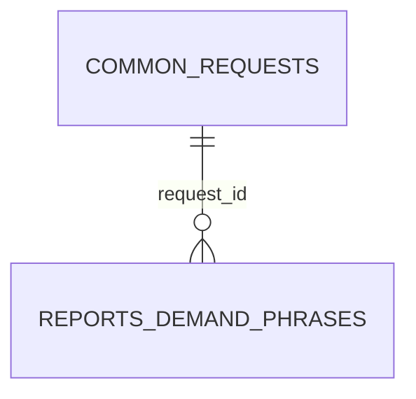

<!-- docs-db:generated -->
# Отчётные таблицы

> Автоматически сгенерировано. Не редактировать вручную.

Таблиц: 14. Представлений: 15.

## Таблицы

### `reports.demand_phrases`

Описание не задано.

#### Колонки

| # | Колонка | Тип | Допустимость | Атрибуты | По умолчанию | Описание |
|---:|---|---|---|---|---|---|
| 1 | `request_id` | `integer` | NOT NULL | — | — | — |
| 2 | `product` | `text` | NOT NULL | — | — | — |
| 3 | `topvisor_group` | `text` | NULL | — | — | — |
| 4 | `source` | `text` | NOT NULL | — | Есть; выражение скрыто до проверки | — |
| 5 | `is_active` | `boolean` | NOT NULL | — | `true` | — |
| 6 | `fetched_from` | `date` | NULL | — | — | — |
| 7 | `fetched_to` | `date` | NULL | — | — | — |
| 8 | `fetched_at` | `timestamp without time zone` | NULL | — | — | — |
| 9 | `created_at` | `timestamp without time zone` | NULL | — | `CURRENT_TIMESTAMP` | — |

#### Первичный ключ

`demand_phrases_pkey`: `request_id`, `product`

#### Внешние ключи

| Ограничение | Колонки | Ссылка | ON DELETE | ON UPDATE |
|---|---|---|---|---|
| `demand_phrases_request_id_fkey` | `request_id` | `common.requests` (`request_id`) | NO ACTION | NO ACTION |

#### Индексы

| Имя | Тип | Уникальный | Колонки | Особенности |
|---|---|:---:|---|---|
| `demand_phrases_pkey` | `btree` | да | `request_id`, `product` | PRIMARY KEY |

### `reports.ga4_customer_events`

События GA4, сгруппированные по дате, клиенту и типу события.

> Ограниченный режим: публикуются только структура и проверенные описания. Реальные значения и примеры запрещены.

#### Колонки

| # | Колонка | Тип | Допустимость | Атрибуты | По умолчанию | Описание |
|---:|---|---|---|---|---|---|
| 1 | `event_date` | `date` | NOT NULL | — | — | — |
| 2 | `customer_id` | `text` | NOT NULL | — | — | Внутренний идентификатор клиента; значения не публикуются. |
| 3 | `event_name` | `text` | NOT NULL | — | — | — |
| 4 | `first_channel` | `text` | NOT NULL | — | `''` | Значения не публикуются. |
| 5 | `first_source` | `text` | NOT NULL | — | `''` | Значения не публикуются. |
| 6 | `first_medium` | `text` | NOT NULL | — | `''` | Значения не публикуются. |
| 7 | `first_campaign` | `text` | NOT NULL | — | `''` | Значения не публикуются. |
| 8 | `event_count` | `integer` | NOT NULL | — | — | — |
| 9 | `created_at` | `timestamp without time zone` | NULL | — | `CURRENT_TIMESTAMP` | — |

#### Первичный ключ

`ga4_customer_events_pkey`: `event_date`, `customer_id`, `event_name`, `first_channel`, `first_source`, `first_medium`, `first_campaign`

#### Индексы

| Имя | Тип | Уникальный | Колонки | Особенности |
|---|---|:---:|---|---|
| `ga4_customer_events_pkey` | `btree` | да | `event_date`, `customer_id`, `event_name`, `first_channel`, `first_source`, `first_medium`, `first_campaign` | PRIMARY KEY |
| `idx_ga4_customer_events_cust` | `btree` | нет | `customer_id` | — |

### `reports.ga4_customer_purchases`

События покупок GA4 по клиентам и транзакциям.

> Ограниченный режим: публикуются только структура и проверенные описания. Реальные значения и примеры запрещены.

#### Колонки

| # | Колонка | Тип | Допустимость | Атрибуты | По умолчанию | Описание |
|---:|---|---|---|---|---|---|
| 1 | `event_date` | `date` | NOT NULL | — | — | — |
| 2 | `customer_id` | `text` | NOT NULL | — | — | Внутренний идентификатор клиента; значения не публикуются. |
| 3 | `transaction_id` | `text` | NOT NULL | — | `''` | Идентификатор транзакции; значения не публикуются. |
| 4 | `coupon` | `text` | NOT NULL | — | `''` | Код купона; значения не публикуются. |
| 5 | `currency` | `text` | NOT NULL | — | `''` | Значения не публикуются. |
| 6 | `value` | `numeric(14,2)` | NOT NULL | — | `0` | Денежное значение покупки; значения не публикуются. |
| 7 | `payment_type` | `text` | NOT NULL | — | `''` | Значения не публикуются. |
| 8 | `period` | `text` | NOT NULL | — | `''` | Значения не публикуются. |
| 9 | `event_count` | `integer` | NOT NULL | — | — | — |
| 10 | `created_at` | `timestamp without time zone` | NULL | — | `CURRENT_TIMESTAMP` | — |

#### Первичный ключ

`ga4_customer_purchases_pkey`: `event_date`, `customer_id`, `transaction_id`, `coupon`, `currency`, `payment_type`, `period`, `value`

#### Индексы

| Имя | Тип | Уникальный | Колонки | Особенности |
|---|---|:---:|---|---|
| `ga4_customer_purchases_pkey` | `btree` | да | `event_date`, `customer_id`, `transaction_id`, `coupon`, `currency`, `payment_type`, `period`, `value` | PRIMARY KEY |
| `idx_ga4_customer_purchases_cust` | `btree` | нет | `customer_id` | — |

### `reports.gsc_segment_monthly`

Описание не задано.

#### Колонки

| # | Колонка | Тип | Допустимость | Атрибуты | По умолчанию | Описание |
|---:|---|---|---|---|---|---|
| 1 | `month` | `date` | NOT NULL | — | — | — |
| 2 | `segment` | `text` | NOT NULL | — | — | — |
| 3 | `clicks` | `bigint` | NOT NULL | — | `0` | — |
| 4 | `impressions` | `bigint` | NOT NULL | — | `0` | — |
| 5 | `avg_position` | `numeric` | NULL | — | — | — |
| 6 | `days_with_data` | `smallint` | NOT NULL | — | — | — |
| 7 | `days_in_month` | `smallint` | NOT NULL | — | — | — |
| 8 | `computed_at` | `timestamp without time zone` | NULL | — | `CURRENT_TIMESTAMP` | — |

#### Первичный ключ

`gsc_segment_monthly_pkey`: `month`, `segment`

#### Индексы

| Имя | Тип | Уникальный | Колонки | Особенности |
|---|---|:---:|---|---|
| `gsc_segment_monthly_pkey` | `btree` | да | `month`, `segment` | PRIMARY KEY |

### `reports.purchases_kpi`

Описание не задано.

#### Колонки

| # | Колонка | Тип | Допустимость | Атрибуты | По умолчанию | Описание |
|---:|---|---|---|---|---|---|
| 1 | `product` | `text` | NOT NULL | — | — | — |
| 2 | `metric` | `text` | NOT NULL | — | — | — |
| 3 | `quarter_start` | `date` | NOT NULL | — | — | — |
| 4 | `low` | `numeric(14,2)` | NOT NULL | — | — | — |
| 5 | `mid` | `numeric(14,2)` | NOT NULL | — | — | — |
| 6 | `high` | `numeric(14,2)` | NOT NULL | — | — | — |
| 7 | `reliability` | `text` | NOT NULL | — | — | — |
| 8 | `basis` | `text` | NULL | — | — | — |
| 9 | `created_at` | `timestamp without time zone` | NOT NULL | — | `CURRENT_TIMESTAMP` | — |

#### Первичный ключ

`purchases_kpi_pkey`: `product`, `metric`, `quarter_start`

#### Индексы

| Имя | Тип | Уникальный | Колонки | Особенности |
|---|---|:---:|---|---|
| `purchases_kpi_pkey` | `btree` | да | `product`, `metric`, `quarter_start` | PRIMARY KEY |

### `reports.purchases_monthly`

Описание не задано.

#### Колонки

| # | Колонка | Тип | Допустимость | Атрибуты | По умолчанию | Описание |
|---:|---|---|---|---|---|---|
| 1 | `month` | `date` | NOT NULL | — | — | — |
| 2 | `product` | `text` | NOT NULL | — | — | — |
| 3 | `new_payers` | `integer` | NOT NULL | — | — | — |
| 4 | `revenue_rub` | `numeric(14,2)` | NOT NULL | — | — | — |
| 5 | `invoices` | `integer` | NOT NULL | — | — | — |
| 6 | `updated_at` | `timestamp without time zone` | NOT NULL | — | `CURRENT_TIMESTAMP` | — |

#### Первичный ключ

`purchases_monthly_pkey`: `month`, `product`

#### Индексы

| Имя | Тип | Уникальный | Колонки | Особенности |
|---|---|:---:|---|---|
| `purchases_monthly_pkey` | `btree` | да | `month`, `product` | PRIMARY KEY |

### `reports.purchases_overall_monthly`

Описание не задано.

#### Колонки

| # | Колонка | Тип | Допустимость | Атрибуты | По умолчанию | Описание |
|---:|---|---|---|---|---|---|
| 1 | `month` | `date` | NOT NULL | — | — | — |
| 2 | `new_payers_total` | `integer` | NULL | — | — | — |
| 3 | `new_payers_organic` | `integer` | NULL | — | — | — |
| 4 | `revenue_organic_rub` | `numeric(14,2)` | NULL | — | — | — |
| 5 | `invoices_organic` | `integer` | NULL | — | — | — |
| 6 | `updated_at` | `timestamp without time zone` | NOT NULL | — | `CURRENT_TIMESTAMP` | — |

#### Первичный ключ

`purchases_overall_monthly_pkey`: `month`

#### Индексы

| Имя | Тип | Уникальный | Колонки | Особенности |
|---|---|:---:|---|---|
| `purchases_overall_monthly_pkey` | `btree` | да | `month` | PRIMARY KEY |

### `reports.seasonality_events`

Описание не задано.

#### Колонки

| # | Колонка | Тип | Допустимость | Атрибуты | По умолчанию | Описание |
|---:|---|---|---|---|---|---|
| 1 | `id` | `integer` | NOT NULL | — | `nextval(…)` | — |
| 2 | `site` | `text` | NULL | — | — | — |
| 3 | `month_from` | `date` | NOT NULL | — | — | — |
| 4 | `month_to` | `date` | NOT NULL | — | — | — |
| 5 | `action` | `text` | NOT NULL | — | Есть; выражение скрыто до проверки | — |
| 6 | `applies_to` | `text` | NOT NULL | — | Есть; выражение скрыто до проверки | — |
| 7 | `description` | `text` | NOT NULL | — | — | — |
| 8 | `created_at` | `timestamp without time zone` | NULL | — | `CURRENT_TIMESTAMP` | — |

#### Первичный ключ

`seasonality_events_pkey`: `id`

#### CHECK-ограничения

- `seasonality_events_action_check` — выражение скрыто до проверки.
- `seasonality_events_applies_to_check` — выражение скрыто до проверки.
- `seasonality_events_site_check` — выражение скрыто до проверки.

#### Индексы

| Имя | Тип | Уникальный | Колонки | Особенности |
|---|---|:---:|---|---|
| `seasonality_events_pkey` | `btree` | да | `id` | PRIMARY KEY |

### `reports.seasonality_index`

Описание не задано.

#### Колонки

| # | Колонка | Тип | Допустимость | Атрибуты | По умолчанию | Описание |
|---:|---|---|---|---|---|---|
| 1 | `series` | `text` | NOT NULL | — | — | — |
| 2 | `site` | `text` | NOT NULL | — | — | — |
| 3 | `month_num` | `smallint` | NOT NULL | — | — | — |
| 4 | `seasonal_index` | `numeric` | NULL | — | — | — |
| 5 | `seasons_used` | `smallint` | NOT NULL | — | — | — |
| 6 | `seasons_list` | `text` | NULL | — | — | — |
| 7 | `method_note` | `text` | NULL | — | — | — |
| 8 | `computed_at` | `timestamp without time zone` | NULL | — | `CURRENT_TIMESTAMP` | — |

#### Первичный ключ

`seasonality_index_pkey`: `series`, `site`, `month_num`

#### CHECK-ограничения

- `seasonality_index_month_num_check` — выражение скрыто до проверки.

#### Индексы

| Имя | Тип | Уникальный | Колонки | Особенности |
|---|---|:---:|---|---|
| `seasonality_index_pkey` | `btree` | да | `series`, `site`, `month_num` | PRIMARY KEY |

### `reports.seasonality_monthly`

Описание не задано.

#### Колонки

| # | Колонка | Тип | Допустимость | Атрибуты | По умолчанию | Описание |
|---:|---|---|---|---|---|---|
| 1 | `series` | `text` | NOT NULL | — | — | — |
| 2 | `site` | `text` | NOT NULL | — | — | — |
| 3 | `month` | `date` | NOT NULL | — | — | — |
| 4 | `value` | `bigint` | NOT NULL | — | — | — |
| 5 | `status` | `text` | NOT NULL | — | — | — |
| 6 | `note` | `text` | NULL | — | — | — |
| 7 | `season` | `text` | NULL | — | — | — |
| 8 | `season_baseline` | `numeric` | NULL | — | — | — |
| 9 | `month_index` | `numeric` | NULL | — | — | — |
| 10 | `computed_at` | `timestamp without time zone` | NULL | — | `CURRENT_TIMESTAMP` | — |
| 11 | `value_per_day` | `numeric` | NULL | — | — | — |

#### Первичный ключ

`seasonality_monthly_pkey`: `series`, `site`, `month`

#### Индексы

| Имя | Тип | Уникальный | Колонки | Особенности |
|---|---|:---:|---|---|
| `seasonality_monthly_pkey` | `btree` | да | `series`, `site`, `month` | PRIMARY KEY |

### `reports.seo_traffic_norm`

Описание не задано.

#### Колонки

| # | Колонка | Тип | Допустимость | Атрибуты | По умолчанию | Описание |
|---:|---|---|---|---|---|---|
| 1 | `series` | `text` | NOT NULL | — | — | — |
| 2 | `site` | `text` | NOT NULL | — | — | — |
| 3 | `month` | `date` | NOT NULL | — | — | — |
| 4 | `is_forecast` | `boolean` | NOT NULL | — | — | — |
| 5 | `days_in_month` | `smallint` | NOT NULL | — | — | — |
| 6 | `level_per_day` | `numeric` | NULL | — | — | — |
| 7 | `seasonal_index` | `numeric` | NULL | — | — | — |
| 8 | `seasons_used` | `smallint` | NULL | — | — | — |
| 9 | `confidence` | `text` | NULL | — | — | — |
| 10 | `expected_per_day` | `numeric` | NULL | — | — | — |
| 11 | `expected_total` | `bigint` | NULL | — | — | — |
| 12 | `band_pct` | `numeric` | NULL | — | — | — |
| 13 | `expected_low` | `bigint` | NULL | — | — | — |
| 14 | `expected_high` | `bigint` | NULL | — | — | — |
| 15 | `actual_total` | `bigint` | NULL | — | — | — |
| 16 | `actual_per_day` | `numeric` | NULL | — | — | — |
| 17 | `deviation_pct` | `numeric` | NULL | — | — | — |
| 18 | `status` | `text` | NOT NULL | — | — | — |
| 19 | `basis` | `text` | NULL | — | — | — |
| 20 | `computed_at` | `timestamp without time zone` | NULL | — | `CURRENT_TIMESTAMP` | — |
| 21 | `in_sample` | `boolean` | NOT NULL | — | `false` | — |

#### Первичный ключ

`seo_traffic_norm_pkey`: `series`, `site`, `month`

#### Индексы

| Имя | Тип | Уникальный | Колонки | Особенности |
|---|---|:---:|---|---|
| `seo_traffic_norm_pkey` | `btree` | да | `series`, `site`, `month` | PRIMARY KEY |

### `reports.traffic_daily`

Описание не задано.

#### Колонки

| # | Колонка | Тип | Допустимость | Атрибуты | По умолчанию | Описание |
|---:|---|---|---|---|---|---|
| 1 | `source` | `text` | NOT NULL | — | — | — |
| 2 | `site` | `text` | NOT NULL | — | — | — |
| 3 | `host` | `text` | NOT NULL | — | — | — |
| 4 | `event_date` | `date` | NOT NULL | — | — | — |
| 5 | `channel` | `text` | NOT NULL | — | — | — |
| 6 | `sessions` | `integer` | NOT NULL | — | `0` | — |
| 7 | `engaged_sessions` | `integer` | NULL | — | — | — |
| 8 | `users` | `integer` | NOT NULL | — | `0` | — |
| 9 | `new_users` | `integer` | NOT NULL | — | `0` | — |
| 10 | `pageviews` | `integer` | NOT NULL | — | `0` | — |
| 11 | `created_at` | `timestamp without time zone` | NULL | — | `CURRENT_TIMESTAMP` | — |
| 12 | `updated_at` | `timestamp without time zone` | NULL | — | `CURRENT_TIMESTAMP` | — |

#### Первичный ключ

`traffic_daily_pkey`: `source`, `site`, `event_date`, `channel`

#### Индексы

| Имя | Тип | Уникальный | Колонки | Особенности |
|---|---|:---:|---|---|
| `idx_traffic_daily_date` | `btree` | нет | `event_date` | — |
| `traffic_daily_pkey` | `btree` | да | `source`, `site`, `event_date`, `channel` | PRIMARY KEY |

### `reports.traffic_organic_engine`

Описание не задано.

#### Колонки

| # | Колонка | Тип | Допустимость | Атрибуты | По умолчанию | Описание |
|---:|---|---|---|---|---|---|
| 1 | `source` | `text` | NOT NULL | — | — | — |
| 2 | `site` | `text` | NOT NULL | — | — | — |
| 3 | `host` | `text` | NOT NULL | — | — | — |
| 4 | `event_date` | `date` | NOT NULL | — | — | — |
| 5 | `engine` | `text` | NOT NULL | — | — | — |
| 6 | `sessions` | `integer` | NOT NULL | — | `0` | — |
| 7 | `users` | `integer` | NOT NULL | — | `0` | — |
| 8 | `new_users` | `integer` | NOT NULL | — | `0` | — |
| 9 | `pageviews` | `integer` | NOT NULL | — | `0` | — |
| 10 | `created_at` | `timestamp without time zone` | NULL | — | `CURRENT_TIMESTAMP` | — |
| 11 | `updated_at` | `timestamp without time zone` | NULL | — | `CURRENT_TIMESTAMP` | — |

#### Первичный ключ

`traffic_organic_engine_pkey`: `source`, `site`, `event_date`, `engine`

#### Индексы

| Имя | Тип | Уникальный | Колонки | Особенности |
|---|---|:---:|---|---|
| `idx_traffic_organic_engine_date` | `btree` | нет | `event_date` | — |
| `traffic_organic_engine_pkey` | `btree` | да | `source`, `site`, `event_date`, `engine` | PRIMARY KEY |

### `reports.traffic_organic_landing`

Описание не задано.

#### Колонки

| # | Колонка | Тип | Допустимость | Атрибуты | По умолчанию | Описание |
|---:|---|---|---|---|---|---|
| 1 | `source` | `text` | NOT NULL | — | — | — |
| 2 | `site` | `text` | NOT NULL | — | — | — |
| 3 | `month` | `date` | NOT NULL | — | — | — |
| 4 | `page` | `text` | NOT NULL | — | — | — |
| 5 | `engine` | `text` | NOT NULL | — | — | — |
| 6 | `sessions` | `integer` | NOT NULL | — | `0` | — |
| 7 | `created_at` | `timestamp without time zone` | NULL | — | `CURRENT_TIMESTAMP` | — |
| 8 | `updated_at` | `timestamp without time zone` | NULL | — | `CURRENT_TIMESTAMP` | — |

#### Первичный ключ

`traffic_organic_landing_pkey`: `source`, `site`, `month`, `page`, `engine`

#### Индексы

| Имя | Тип | Уникальный | Колонки | Особенности |
|---|---|:---:|---|---|
| `idx_traffic_organic_landing_month` | `btree` | нет | `month` | — |
| `traffic_organic_landing_pkey` | `btree` | да | `source`, `site`, `month`, `page`, `engine` | PRIMARY KEY |

## Представления

### `reports.v_demand_index_monthly`

Описание не задано.

| # | Колонка | Тип | Описание |
|---:|---|---|---|
| 1 | `product` | `text` | — |
| 2 | `month` | `date` | — |
| 3 | `frequency` | `bigint` | — |
| 4 | `idx` | `numeric` | — |
| 5 | `phrases` | `integer` | — |

#### Зависимости

- `reports.demand_phrases`
- `wordstat.dynamics_range`

### `reports.v_demand_index_yoy`

Описание не задано.

| # | Колонка | Тип | Описание |
|---:|---|---|---|
| 1 | `product` | `text` | — |
| 2 | `month` | `date` | — |
| 3 | `frequency` | `bigint` | — |
| 4 | `frequency_prev_year` | `bigint` | — |
| 5 | `yoy_pct` | `numeric` | — |
| 6 | `comparable` | `boolean` | — |
| 7 | `phrases` | `integer` | — |

#### Зависимости

- `reports.v_demand_index_monthly`

### `reports.v_demand_product_monthly`

Описание не задано.

| # | Колонка | Тип | Описание |
|---:|---|---|---|
| 1 | `product` | `text` | — |
| 2 | `month` | `date` | — |
| 3 | `frequency` | `bigint` | — |
| 4 | `phrases` | `bigint` | — |

#### Зависимости

- `reports.demand_phrases`
- `wordstat.dynamics_range`

### `reports.v_demand_yoy`

Описание не задано.

| # | Колонка | Тип | Описание |
|---:|---|---|---|
| 1 | `product` | `text` | — |
| 2 | `month` | `date` | — |
| 3 | `frequency` | `bigint` | — |
| 4 | `frequency_prev_year` | `bigint` | — |
| 5 | `yoy_pct` | `numeric` | — |
| 6 | `comparable` | `boolean` | — |
| 7 | `phrases` | `bigint` | — |

#### Зависимости

- `reports.v_demand_product_monthly`

### `reports.v_ga4_customer_journey`

Представление основных этапов регистрации и покупок клиента.

> Ограниченный режим: публикуются только структура и проверенные описания. Реальные значения и примеры запрещены.

| # | Колонка | Тип | Описание |
|---:|---|---|---|
| 1 | `customer_id` | `text` | Внутренний идентификатор клиента; значения не публикуются. |
| 2 | `first_channel` | `text` | Значения не публикуются. |
| 3 | `first_source` | `text` | Значения не публикуются. |
| 4 | `first_medium` | `text` | Значения не публикуются. |
| 5 | `reg_date` | `date` | — |
| 6 | `first_purchase_date` | `date` | — |
| 7 | `days_to_purchase` | `integer` | — |
| 8 | `checkouts` | `bigint` | — |
| 9 | `purchases` | `bigint` | — |
| 10 | `had_l3_test` | `boolean` | — |
| 11 | `had_other_coupon` | `boolean` | — |

#### Зависимости

- `reports.ga4_customer_events`
- `reports.ga4_customer_purchases`

### `reports.v_ga4_months_complete`

Описание не задано.

| # | Колонка | Тип | Описание |
|---:|---|---|---|
| 1 | `month` | `date` | — |
| 2 | `complete` | `boolean` | — |

#### Зависимости

- `reports.v_organic_engine_monthly`

### `reports.v_ga4_registration_funnel_monthly`

Описание не задано.

| # | Колонка | Тип | Описание |
|---:|---|---|---|
| 1 | `month` | `date` | — |
| 2 | `grp` | `text` | — |
| 3 | `registered` | `bigint` | — |
| 4 | `paid_same_day` | `bigint` | — |
| 5 | `paid_30d` | `bigint` | — |
| 6 | `paid_90d` | `bigint` | — |
| 7 | `paid_any` | `bigint` | — |
| 8 | `l3_test` | `bigint` | — |

#### Зависимости

- `reports.v_ga4_customer_journey`

### `reports.v_gsc_segment_share`

Описание не задано.

| # | Колонка | Тип | Описание |
|---:|---|---|---|
| 1 | `month` | `date` | — |
| 2 | `segment` | `text` | — |
| 3 | `clicks` | `bigint` | — |
| 4 | `days_with_data` | `smallint` | — |
| 5 | `days_in_month` | `smallint` | — |
| 6 | `clicks_per_day` | `numeric` | — |
| 7 | `clicks_share_pct` | `numeric` | — |
| 8 | `avg_position` | `numeric` | — |

#### Зависимости

- `reports.gsc_segment_monthly`

### `reports.v_landing_page_group`

Описание не задано.

| # | Колонка | Тип | Описание |
|---:|---|---|---|
| 1 | `url_norm` | `text` | — |
| 2 | `grp` | `text` | — |

#### Зависимости

- `analytics.v_topvisor_group_target_urls`

### `reports.v_organic_engine_monthly`

Описание не задано.

| # | Колонка | Тип | Описание |
|---:|---|---|---|
| 1 | `source` | `text` | — |
| 2 | `site` | `text` | — |
| 3 | `engine` | `text` | — |
| 4 | `month` | `date` | — |
| 5 | `sessions` | `bigint` | — |
| 6 | `days_with_data` | `bigint` | — |

#### Зависимости

- `reports.traffic_organic_engine`

### `reports.v_purchases_vs_traffic_quarterly`

Описание не задано.

| # | Колонка | Тип | Описание |
|---:|---|---|---|
| 1 | `quarter` | `date` | — |
| 2 | `grp` | `text` | — |
| 3 | `sessions` | `numeric` | — |
| 4 | `payers` | `bigint` | — |
| 5 | `revenue_rub` | `numeric` | — |
| 6 | `payers_per_1000` | `numeric` | — |
| 7 | `revenue_per_1000` | `numeric` | — |
| 8 | `complete` | `boolean` | — |

#### Зависимости

- `reports.purchases_monthly`
- `reports.v_ga4_months_complete`
- `reports.v_traffic_landing_group_monthly`

### `reports.v_seo_norm_latest`

Описание не задано.

| # | Колонка | Тип | Описание |
|---:|---|---|---|
| 1 | `series` | `text` | — |
| 2 | `series_label` | `text` | — |
| 3 | `sort_order` | `integer` | — |
| 4 | `kind` | `text` | — |
| 5 | `site` | `text` | — |
| 6 | `month` | `date` | — |
| 7 | `is_forecast` | `boolean` | — |
| 8 | `days_in_month` | `smallint` | — |
| 9 | `level_per_day` | `numeric` | — |
| 10 | `seasonal_index` | `numeric` | — |
| 11 | `seasons_used` | `smallint` | — |
| 12 | `confidence` | `text` | — |
| 13 | `expected_per_day` | `numeric` | — |
| 14 | `expected_total` | `bigint` | — |
| 15 | `expected_low` | `bigint` | — |
| 16 | `expected_high` | `bigint` | — |
| 17 | `band_pct` | `numeric` | — |
| 18 | `actual_total` | `bigint` | — |
| 19 | `actual_per_day` | `numeric` | — |
| 20 | `deviation_pct` | `numeric` | — |
| 21 | `status` | `text` | — |
| 22 | `basis` | `text` | — |
| 23 | `in_sample` | `boolean` | — |

#### Зависимости

- `reports.v_seo_norm_report`

### `reports.v_seo_norm_report`

Описание не задано.

| # | Колонка | Тип | Описание |
|---:|---|---|---|
| 1 | `series` | `text` | — |
| 2 | `series_label` | `text` | — |
| 3 | `sort_order` | `integer` | — |
| 4 | `kind` | `text` | — |
| 5 | `site` | `text` | — |
| 6 | `month` | `date` | — |
| 7 | `is_forecast` | `boolean` | — |
| 8 | `days_in_month` | `smallint` | — |
| 9 | `level_per_day` | `numeric` | — |
| 10 | `seasonal_index` | `numeric` | — |
| 11 | `seasons_used` | `smallint` | — |
| 12 | `confidence` | `text` | — |
| 13 | `expected_per_day` | `numeric` | — |
| 14 | `expected_total` | `bigint` | — |
| 15 | `expected_low` | `bigint` | — |
| 16 | `expected_high` | `bigint` | — |
| 17 | `band_pct` | `numeric` | — |
| 18 | `actual_total` | `bigint` | — |
| 19 | `actual_per_day` | `numeric` | — |
| 20 | `deviation_pct` | `numeric` | — |
| 21 | `status` | `text` | — |
| 22 | `basis` | `text` | — |
| 23 | `in_sample` | `boolean` | — |

#### Зависимости

- `reports.seo_traffic_norm`

### `reports.v_traffic_landing_group_monthly`

Описание не задано.

| # | Колонка | Тип | Описание |
|---:|---|---|---|
| 1 | `source` | `text` | — |
| 2 | `site` | `text` | — |
| 3 | `month` | `date` | — |
| 4 | `engine` | `text` | — |
| 5 | `grp` | `text` | — |
| 6 | `sessions` | `bigint` | — |
| 7 | `pages` | `bigint` | — |

#### Зависимости

- `reports.traffic_organic_landing`
- `reports.v_landing_page_group`

### `reports.v_traffic_vs_payers_site_quarterly`

Описание не задано.

| # | Колонка | Тип | Описание |
|---:|---|---|---|
| 1 | `quarter` | `date` | — |
| 2 | `home` | `numeric` | — |
| 3 | `product_pages` | `numeric` | — |
| 4 | `informational` | `numeric` | — |
| 5 | `other` | `numeric` | — |
| 6 | `payers` | `bigint` | — |
| 7 | `revenue_rub` | `numeric` | — |
| 8 | `complete` | `boolean` | — |

#### Зависимости

- `reports.purchases_overall_monthly`
- `reports.v_ga4_months_complete`
- `reports.v_traffic_landing_group_monthly`

## Диаграмма физических связей

[Назад к навигации](index.md)
