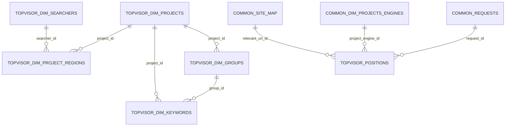

<!-- docs-db:generated -->
# TopVisor

> Автоматически сгенерировано. Не редактировать вручную.

Таблиц: 6. Представлений: 3.

## Таблицы

### `topvisor.dim_groups`

Описание не задано.

#### Колонки

| # | Колонка | Тип | Допустимость | Атрибуты | По умолчанию | Описание |
|---:|---|---|---|---|---|---|
| 1 | `id` | `integer` | NOT NULL | — | — | — |
| 2 | `project_id` | `integer` | NOT NULL | — | — | — |
| 3 | `folder_id` | `integer` | NULL | — | — | — |
| 4 | `name` | `text` | NOT NULL | — | — | — |
| 5 | `is_on` | `boolean` | NULL | — | — | — |
| 6 | `count_keywords` | `integer` | NULL | — | — | — |
| 7 | `created_at` | `timestamp without time zone` | NULL | — | `CURRENT_TIMESTAMP` | — |
| 8 | `updated_at` | `timestamp without time zone` | NULL | — | `CURRENT_TIMESTAMP` | — |

#### Первичный ключ

`dim_groups_pkey`: `id`

#### Внешние ключи

| Ограничение | Колонки | Ссылка | ON DELETE | ON UPDATE |
|---|---|---|---|---|
| `dim_groups_project_id_fkey` | `project_id` | `topvisor.dim_projects` (`id`) | NO ACTION | NO ACTION |

#### Индексы

| Имя | Тип | Уникальный | Колонки | Особенности |
|---|---|:---:|---|---|
| `dim_groups_pkey` | `btree` | да | `id` | PRIMARY KEY |
| `idx_dim_groups_project` | `btree` | нет | `project_id` | — |

### `topvisor.dim_keywords`

Описание не задано.

#### Колонки

| # | Колонка | Тип | Допустимость | Атрибуты | По умолчанию | Описание |
|---:|---|---|---|---|---|---|
| 1 | `id` | `integer` | NOT NULL | — | — | — |
| 2 | `project_id` | `integer` | NOT NULL | — | — | — |
| 3 | `group_id` | `integer` | NULL | — | — | — |
| 4 | `name` | `text` | NOT NULL | — | — | — |
| 5 | `target` | `text` | NULL | — | — | — |
| 6 | `created_at` | `timestamp without time zone` | NULL | — | `CURRENT_TIMESTAMP` | — |
| 7 | `updated_at` | `timestamp without time zone` | NULL | — | `CURRENT_TIMESTAMP` | — |

#### Первичный ключ

`dim_keywords_pkey`: `id`

#### Внешние ключи

| Ограничение | Колонки | Ссылка | ON DELETE | ON UPDATE |
|---|---|---|---|---|
| `dim_keywords_group_id_fkey` | `group_id` | `topvisor.dim_groups` (`id`) | NO ACTION | NO ACTION |
| `dim_keywords_project_id_fkey` | `project_id` | `topvisor.dim_projects` (`id`) | NO ACTION | NO ACTION |

#### Индексы

| Имя | Тип | Уникальный | Колонки | Особенности |
|---|---|:---:|---|---|
| `dim_keywords_pkey` | `btree` | да | `id` | PRIMARY KEY |
| `idx_dim_keywords_group` | `btree` | нет | `group_id` | — |
| `idx_dim_keywords_project` | `btree` | нет | `project_id` | — |

### `topvisor.dim_project_regions`

Описание не задано.

#### Колонки

| # | Колонка | Тип | Допустимость | Атрибуты | По умолчанию | Описание |
|---:|---|---|---|---|---|---|
| 1 | `id` | `integer` | NOT NULL | — | `nextval(…)` | — |
| 2 | `project_id` | `integer` | NOT NULL | — | — | — |
| 3 | `searcher_id` | `integer` | NOT NULL | — | — | — |
| 4 | `region_name` | `text` | NULL | — | — | — |
| 5 | `country_code` | `text` | NULL | — | — | — |
| 6 | `lang` | `text` | NULL | — | — | — |
| 7 | `device` | `smallint` | NULL | — | — | — |
| 8 | `depth` | `smallint` | NULL | — | — | — |
| 9 | `updated_at` | `timestamp without time zone` | NULL | — | `CURRENT_TIMESTAMP` | — |

#### Первичный ключ

`dim_project_regions_pkey`: `id`

#### Внешние ключи

| Ограничение | Колонки | Ссылка | ON DELETE | ON UPDATE |
|---|---|---|---|---|
| `dim_project_regions_project_id_fkey` | `project_id` | `topvisor.dim_projects` (`id`) | NO ACTION | NO ACTION |
| `dim_project_regions_searcher_id_fkey` | `searcher_id` | `topvisor.dim_searchers` (`id`) | NO ACTION | NO ACTION |

#### Уникальные ограничения

- `dim_project_regions_project_id_searcher_id_region_name_devi_key`: `project_id`, `searcher_id`, `region_name`, `device`

#### Индексы

| Имя | Тип | Уникальный | Колонки | Особенности |
|---|---|:---:|---|---|
| `dim_project_regions_pkey` | `btree` | да | `id` | PRIMARY KEY |
| `dim_project_regions_project_id_searcher_id_region_name_devi_key` | `btree` | да | `project_id`, `searcher_id`, `region_name`, `device` | — |
| `idx_dim_project_regions_project` | `btree` | нет | `project_id` | — |
| `idx_dim_project_regions_searcher` | `btree` | нет | `searcher_id` | — |

### `topvisor.dim_projects`

Описание не задано.

#### Колонки

| # | Колонка | Тип | Допустимость | Атрибуты | По умолчанию | Описание |
|---:|---|---|---|---|---|---|
| 1 | `id` | `integer` | NOT NULL | — | — | — |
| 2 | `name` | `text` | NOT NULL | — | — | — |
| 3 | `url` | `text` | NULL | — | — | — |
| 4 | `created_at` | `timestamp without time zone` | NULL | — | `CURRENT_TIMESTAMP` | — |
| 5 | `updated_at` | `timestamp without time zone` | NULL | — | `CURRENT_TIMESTAMP` | — |

#### Первичный ключ

`dim_projects_pkey`: `id`

#### Индексы

| Имя | Тип | Уникальный | Колонки | Особенности |
|---|---|:---:|---|---|
| `dim_projects_pkey` | `btree` | да | `id` | PRIMARY KEY |

### `topvisor.dim_searchers`

Описание не задано.

#### Колонки

| # | Колонка | Тип | Допустимость | Атрибуты | По умолчанию | Описание |
|---:|---|---|---|---|---|---|
| 1 | `id` | `integer` | NOT NULL | — | — | — |
| 2 | `name` | `text` | NOT NULL | — | — | — |

#### Первичный ключ

`dim_searchers_pkey`: `id`

#### Индексы

| Имя | Тип | Уникальный | Колонки | Особенности |
|---|---|:---:|---|---|
| `dim_searchers_pkey` | `btree` | да | `id` | PRIMARY KEY |

### `topvisor.positions`

Позиции поисковых запросов по проектам и поисковым системам.

#### Колонки

| # | Колонка | Тип | Допустимость | Атрибуты | По умолчанию | Описание |
|---:|---|---|---|---|---|---|
| 2 | `request` | `text` | NOT NULL | — | — | — |
| 3 | `event_date` | `date` | NOT NULL | — | — | — |
| 6 | `position` | `integer` | NULL | — | — | — |
| 10 | `project_engine_id` | `integer` | NULL | — | — | — |
| 11 | `id` | `integer` | NOT NULL | — | `nextval(…)` | — |
| 12 | `relevant_url_id` | `integer` | NULL | — | — | — |
| 13 | `cluster_topvisor_id` | `integer` | NULL | — | — | — |
| 14 | `request_id` | `integer` | NULL | — | — | — |

#### Первичный ключ

`positions_pkey`: `id`

#### Внешние ключи

| Ограничение | Колонки | Ссылка | ON DELETE | ON UPDATE |
|---|---|---|---|---|
| `fk_positions_request` | `request_id` | `common.requests` (`request_id`) | SET NULL | NO ACTION |
| `fk_project_engine` | `project_engine_id` | `common.dim_projects_engines` (`id`) | NO ACTION | NO ACTION |
| `positions_relevant_url_id_fkey` | `relevant_url_id` | `common.site_map` (`id`) | NO ACTION | NO ACTION |

#### Индексы

| Имя | Тип | Уникальный | Колонки | Особенности |
|---|---|:---:|---|---|
| `idx_positions_cluster_topvisor` | `btree` | нет | `cluster_topvisor_id` | — |
| `idx_positions_event_date` | `btree` | нет | `event_date` | — |
| `idx_positions_position` | `btree` | нет | `position` | частичный; WHERE скрыт до проверки |
| `idx_positions_project_engine` | `btree` | нет | `project_engine_id` | — |
| `idx_positions_relevant_url_id` | `btree` | нет | `relevant_url_id` | — |
| `idx_positions_relevant_url_id_date` | `btree` | нет | `relevant_url_id`, `event_date` | — |
| `idx_positions_request_date` | `btree` | нет | `request`, `event_date` | — |
| `idx_positions_request_id` | `btree` | нет | `request_id` | — |
| `idx_positions_unique` | `btree` | да | `request`, `event_date`, `project_engine_id` | — |
| `idx_positions_unique_check` | `btree` | нет | `request`, `event_date`, `project_engine_id` | — |
| `positions_pkey` | `btree` | да | `id` | PRIMARY KEY |

## Представления

### `topvisor.positions_summary`

Описание не задано.

| # | Колонка | Тип | Описание |
|---:|---|---|---|
| 1 | `project_name` | `character varying(100)` | — |
| 2 | `search_engine` | `character varying(50)` | — |
| 3 | `event_date` | `date` | — |
| 4 | `total_keywords` | `bigint` | — |
| 5 | `positioned_keywords` | `bigint` | — |
| 6 | `top10_positions` | `bigint` | — |
| 7 | `top3_positions` | `bigint` | — |
| 8 | `avg_position` | `numeric` | — |

#### Зависимости

- `common.dim_projects_engines`
- `topvisor.positions`

### `topvisor.positions_top_stats`

Описание не задано.

| # | Колонка | Тип | Описание |
|---:|---|---|---|
| 1 | `event_date` | `date` | — |
| 2 | `top10_count` | `bigint` | — |
| 3 | `top3_count` | `bigint` | — |

#### Зависимости

- `topvisor.positions`

### `topvisor.positions_with_delta`

Описание не задано.

| # | Колонка | Тип | Описание |
|---:|---|---|---|
| 1 | `request` | `text` | — |
| 2 | `event_date` | `date` | — |
| 3 | `position` | `integer` | — |
| 4 | `prev_position` | `integer` | — |
| 5 | `delta_position` | `integer` | — |
| 6 | `in_top10` | `integer` | — |
| 7 | `in_top3` | `integer` | — |

#### Зависимости

- `topvisor.positions`

## Диаграмма физических связей

[Назад к навигации](index.md)
