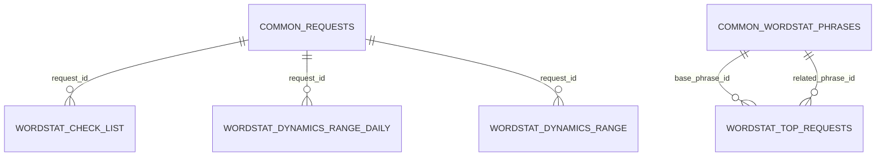

<!-- docs-db:generated -->
# Wordstat

> Автоматически сгенерировано. Не редактировать вручную.

Таблиц: 7. Представлений: 6.

## Таблицы

### `wordstat.check_list`

Описание не задано.

> Ограниченный режим: публикуются только структура и проверенные описания. Реальные значения и примеры запрещены.

#### Колонки

| # | Колонка | Тип | Допустимость | Атрибуты | По умолчанию | Описание |
|---:|---|---|---|---|---|---|
| 1 | `id` | `integer` | NOT NULL | — | `nextval(…)` | — |
| 2 | `request_id` | `integer` | NOT NULL | — | — | — |
| 3 | `method` | `character varying(20)` | NOT NULL | — | — | — |
| 4 | `category` | `character varying(20)` | NULL | — | — | — |
| 5 | `is_active` | `boolean` | NOT NULL | — | `true` | — |
| 6 | `created_at` | `timestamp without time zone` | NULL | — | `CURRENT_TIMESTAMP` | — |
| 7 | `updated_at` | `timestamp without time zone` | NULL | — | `CURRENT_TIMESTAMP` | — |

#### Первичный ключ

`check_list_pkey`: `id`

#### Внешние ключи

| Ограничение | Колонки | Ссылка | ON DELETE | ON UPDATE |
|---|---|---|---|---|
| `check_list_request_id_fkey` | `request_id` | `common.requests` (`request_id`) | NO ACTION | NO ACTION |

#### Уникальные ограничения

- `check_list_request_id_method_key`: `request_id`, `method`

#### CHECK-ограничения

- `check_list_category_check` — выражение скрыто до проверки.
- `check_list_method_check` — выражение скрыто до проверки.

#### Индексы

| Имя | Тип | Уникальный | Колонки | Особенности |
|---|---|:---:|---|---|
| `check_list_pkey` | `btree` | да | `id` | PRIMARY KEY |
| `check_list_request_id_method_key` | `btree` | да | `request_id`, `method` | — |
| `idx_check_list_method_active` | `btree` | нет | `method`, `is_active` | — |

### `wordstat.collection_queue`

Описание не задано.

> Ограниченный режим: публикуются только структура и проверенные описания. Реальные значения и примеры запрещены.

#### Колонки

| # | Колонка | Тип | Допустимость | Атрибуты | По умолчанию | Описание |
|---:|---|---|---|---|---|---|
| 1 | `id` | `integer` | NOT NULL | — | `nextval(…)` | — |
| 2 | `method` | `character varying(20)` | NOT NULL | — | — | — |
| 3 | `phrase` | `text` | NOT NULL | — | — | — |
| 4 | `period_start` | `date` | NULL | — | — | — |
| 5 | `period_end` | `date` | NULL | — | — | — |
| 6 | `check_date` | `date` | NULL | — | — | — |
| 7 | `status` | `character varying(20)` | NOT NULL | — | Есть; выражение скрыто до проверки | — |
| 8 | `attempts` | `integer` | NOT NULL | — | `0` | — |
| 9 | `last_error` | `text` | NULL | — | — | — |
| 10 | `created_at` | `timestamp without time zone` | NULL | — | `CURRENT_TIMESTAMP` | — |
| 11 | `processed_at` | `timestamp without time zone` | NULL | — | — | — |

#### Первичный ключ

`collection_queue_pkey`: `id`

#### Уникальные ограничения

- `collection_queue_method_phrase_period_start_period_end_check_da`: `method`, `phrase`, `period_start`, `period_end`, `check_date`

#### Индексы

| Имя | Тип | Уникальный | Колонки | Особенности |
|---|---|:---:|---|---|
| `collection_queue_method_phrase_period_start_period_end_check_da` | `btree` | да | `method`, `phrase`, `period_start`, `period_end`, `check_date` | — |
| `collection_queue_pkey` | `btree` | да | `id` | PRIMARY KEY |
| `idx_queue_pending` | `btree` | нет | `method`, `status` | — |

### `wordstat.dynamics_range`

Помесячная частотность поисковых запросов за заданный диапазон.

> Ограниченный режим: публикуются только структура и проверенные описания. Реальные значения и примеры запрещены.

#### Колонки

| # | Колонка | Тип | Допустимость | Атрибуты | По умолчанию | Описание |
|---:|---|---|---|---|---|---|
| 2 | `month` | `date` | NOT NULL | — | — | — |
| 3 | `frequency` | `integer` | NOT NULL | — | — | — |
| 4 | `created_at` | `timestamp without time zone` | NULL | — | `CURRENT_TIMESTAMP` | — |
| 5 | `updated_at` | `timestamp without time zone` | NULL | — | `CURRENT_TIMESTAMP` | — |
| 6 | `request_id` | `integer` | NOT NULL | — | — | — |

#### Первичный ключ

`dynamics_range_pkey`: `request_id`, `month`

#### Внешние ключи

| Ограничение | Колонки | Ссылка | ON DELETE | ON UPDATE |
|---|---|---|---|---|
| `fk_dynamics_range_request` | `request_id` | `common.requests` (`request_id`) | NO ACTION | NO ACTION |

#### Индексы

| Имя | Тип | Уникальный | Колонки | Особенности |
|---|---|:---:|---|---|
| `dynamics_range_pkey` | `btree` | да | `request_id`, `month` | PRIMARY KEY |
| `idx_dynamics_range_request` | `btree` | нет | `request_id` | — |

### `wordstat.dynamics_range_daily`

Ежедневная частотность поисковых запросов за заданный диапазон.

> Ограниченный режим: публикуются только структура и проверенные описания. Реальные значения и примеры запрещены.

#### Колонки

| # | Колонка | Тип | Допустимость | Атрибуты | По умолчанию | Описание |
|---:|---|---|---|---|---|---|
| 1 | `request_id` | `integer` | NOT NULL | — | — | — |
| 2 | `day` | `date` | NOT NULL | — | — | — |
| 3 | `frequency` | `integer` | NOT NULL | — | — | — |
| 4 | `created_at` | `timestamp without time zone` | NULL | — | `CURRENT_TIMESTAMP` | — |
| 5 | `updated_at` | `timestamp without time zone` | NULL | — | `CURRENT_TIMESTAMP` | — |

#### Первичный ключ

`dynamics_range_daily_pkey`: `request_id`, `day`

#### Внешние ключи

| Ограничение | Колонки | Ссылка | ON DELETE | ON UPDATE |
|---|---|---|---|---|
| `dynamics_range_daily_request_id_fkey` | `request_id` | `common.requests` (`request_id`) | NO ACTION | NO ACTION |

#### Индексы

| Имя | Тип | Уникальный | Колонки | Особенности |
|---|---|:---:|---|---|
| `dynamics_range_daily_pkey` | `btree` | да | `request_id`, `day` | PRIMARY KEY |
| `idx_dynamics_range_daily_request` | `btree` | нет | `request_id` | — |

### `wordstat.dynamics_range_daily_queue`

Описание не задано.

> Ограниченный режим: публикуются только структура и проверенные описания. Реальные значения и примеры запрещены.

#### Колонки

| # | Колонка | Тип | Допустимость | Атрибуты | По умолчанию | Описание |
|---:|---|---|---|---|---|---|
| 1 | `id` | `integer` | NOT NULL | — | `nextval(…)` | — |
| 2 | `phrase` | `text` | NOT NULL | — | — | — |
| 3 | `status` | `character varying(20)` | NOT NULL | — | Есть; выражение скрыто до проверки | — |
| 4 | `attempts` | `integer` | NOT NULL | — | `0` | — |
| 5 | `last_error` | `text` | NULL | — | — | — |
| 6 | `created_at` | `timestamp without time zone` | NULL | — | `CURRENT_TIMESTAMP` | — |
| 7 | `processed_at` | `timestamp without time zone` | NULL | — | — | — |
| 8 | `cycle_start` | `date` | NOT NULL | — | — | — |

#### Первичный ключ

`dynamics_range_daily_queue_pkey`: `id`

#### Уникальные ограничения

- `dynamics_range_daily_queue_phrase_cycle_key`: `phrase`, `cycle_start`

#### Индексы

| Имя | Тип | Уникальный | Колонки | Особенности |
|---|---|:---:|---|---|
| `dynamics_range_daily_queue_phrase_cycle_key` | `btree` | да | `phrase`, `cycle_start` | — |
| `dynamics_range_daily_queue_pkey` | `btree` | да | `id` | PRIMARY KEY |
| `idx_dynamics_range_daily_queue_cycle` | `btree` | нет | `cycle_start` | — |
| `idx_dynamics_range_daily_queue_status` | `btree` | нет | `status` | — |

### `wordstat.dynamics_range_queue`

Описание не задано.

> Ограниченный режим: публикуются только структура и проверенные описания. Реальные значения и примеры запрещены.

#### Колонки

| # | Колонка | Тип | Допустимость | Атрибуты | По умолчанию | Описание |
|---:|---|---|---|---|---|---|
| 1 | `id` | `integer` | NOT NULL | — | `nextval(…)` | — |
| 2 | `phrase` | `text` | NOT NULL | — | — | — |
| 3 | `status` | `character varying(20)` | NOT NULL | — | Есть; выражение скрыто до проверки | — |
| 4 | `attempts` | `integer` | NOT NULL | — | `0` | — |
| 5 | `last_error` | `text` | NULL | — | — | — |
| 6 | `created_at` | `timestamp without time zone` | NULL | — | `CURRENT_TIMESTAMP` | — |
| 7 | `processed_at` | `timestamp without time zone` | NULL | — | — | — |

#### Первичный ключ

`dynamics_range_queue_pkey`: `id`

#### Уникальные ограничения

- `dynamics_range_queue_phrase_key`: `phrase`

#### Индексы

| Имя | Тип | Уникальный | Колонки | Особенности |
|---|---|:---:|---|---|
| `dynamics_range_queue_phrase_key` | `btree` | да | `phrase` | — |
| `dynamics_range_queue_pkey` | `btree` | да | `id` | PRIMARY KEY |
| `idx_dynamics_range_queue_status` | `btree` | нет | `status` | — |

### `wordstat.top_requests`

Описание не задано.

> Ограниченный режим: публикуются только структура и проверенные описания. Реальные значения и примеры запрещены.

#### Колонки

| # | Колонка | Тип | Допустимость | Атрибуты | По умолчанию | Описание |
|---:|---|---|---|---|---|---|
| 1 | `id` | `integer` | NOT NULL | — | `nextval(…)` | — |
| 2 | `base_phrase_id` | `integer` | NOT NULL | — | — | — |
| 3 | `related_phrase_id` | `integer` | NOT NULL | — | — | — |
| 4 | `count` | `integer` | NOT NULL | — | `0` | — |
| 5 | `check_date` | `date` | NOT NULL | — | — | — |
| 6 | `created_at` | `timestamp without time zone` | NOT NULL | — | `CURRENT_TIMESTAMP` | — |
| 7 | `updated_at` | `timestamp without time zone` | NOT NULL | — | `CURRENT_TIMESTAMP` | — |

#### Первичный ключ

`top_requests_pkey`: `id`

#### Внешние ключи

| Ограничение | Колонки | Ссылка | ON DELETE | ON UPDATE |
|---|---|---|---|---|
| `top_requests_base_phrase_id_fkey` | `base_phrase_id` | `common.wordstat_phrases` (`id`) | NO ACTION | NO ACTION |
| `top_requests_related_phrase_id_fkey` | `related_phrase_id` | `common.wordstat_phrases` (`id`) | NO ACTION | NO ACTION |

#### Уникальные ограничения

- `top_requests_base_phrase_id_related_phrase_id_check_date_key`: `base_phrase_id`, `related_phrase_id`, `check_date`

#### Индексы

| Имя | Тип | Уникальный | Колонки | Особенности |
|---|---|:---:|---|---|
| `idx_top_requests_base` | `btree` | нет | `base_phrase_id` | — |
| `idx_top_requests_base_date` | `btree` | нет | `base_phrase_id`, `check_date` | — |
| `idx_top_requests_date` | `btree` | нет | `check_date` | — |
| `top_requests_base_phrase_id_related_phrase_id_check_date_key` | `btree` | да | `base_phrase_id`, `related_phrase_id`, `check_date` | — |
| `top_requests_pkey` | `btree` | да | `id` | PRIMARY KEY |

## Представления

### `wordstat.dynamics_range_daily_view`

Описание не задано.

> Ограниченный режим: публикуются только структура и проверенные описания. Реальные значения и примеры запрещены.

| # | Колонка | Тип | Описание |
|---:|---|---|---|
| 1 | `request_id` | `integer` | — |
| 2 | `phrase` | `text` | — |
| 3 | `day` | `date` | — |
| 4 | `frequency` | `integer` | — |

#### Зависимости

- `common.requests`
- `wordstat.dynamics_range_daily`

### `wordstat.dynamics_range_view`

Описание не задано.

> Ограниченный режим: публикуются только структура и проверенные описания. Реальные значения и примеры запрещены.

| # | Колонка | Тип | Описание |
|---:|---|---|---|
| 1 | `request_id` | `integer` | — |
| 2 | `phrase` | `text` | — |
| 3 | `month` | `date` | — |
| 4 | `frequency` | `integer` | — |

#### Зависимости

- `common.requests`
- `wordstat.dynamics_range`

### `wordstat.dynamics_summary`

Описание не задано.

> Ограниченный режим: публикуются только структура и проверенные описания. Реальные значения и примеры запрещены.

| # | Колонка | Тип | Описание |
|---:|---|---|---|
| 1 | `request` | `text` | — |
| 2 | `total_months` | `bigint` | — |
| 3 | `total_frequency` | `bigint` | — |
| 4 | `avg_frequency` | `numeric` | — |
| 5 | `min_frequency` | `integer` | — |
| 6 | `max_frequency` | `integer` | — |
| 7 | `first_month` | `date` | — |
| 8 | `last_month` | `date` | — |
| 9 | `group_id` | `smallint` | — |

#### Зависимости

- `common.requests`

### `wordstat.dynamics_with_change`

Описание не задано.

> Ограниченный режим: публикуются только структура и проверенные описания. Реальные значения и примеры запрещены.

| # | Колонка | Тип | Описание |
|---:|---|---|---|
| 1 | `request` | `text` | — |
| 2 | `month` | `text` | — |
| 3 | `frequency` | `integer` | — |
| 4 | `prev_frequency` | `integer` | — |
| 5 | `change` | `integer` | — |
| 6 | `change_percent` | `numeric` | — |
| 7 | `group_id` | `smallint` | — |

#### Зависимости

- `common.requests`

### `wordstat.monthly_trends`

Описание не задано.

> Ограниченный режим: публикуются только структура и проверенные описания. Реальные значения и примеры запрещены.

| # | Колонка | Тип | Описание |
|---:|---|---|---|
| 1 | `month_text` | `text` | — |
| 2 | `month_date` | `date` | — |
| 3 | `unique_requests` | `bigint` | — |
| 4 | `total_frequency` | `bigint` | — |
| 5 | `avg_frequency` | `numeric` | — |
| 6 | `group_id` | `smallint` | — |

#### Зависимости

Разрешённые зависимости не найдены.

### `wordstat.v_check_list_summary`

Описание не задано.

> Ограниченный режим: публикуются только структура и проверенные описания. Реальные значения и примеры запрещены.

| # | Колонка | Тип | Описание |
|---:|---|---|---|
| 1 | `bucket` | `text` | — |
| 2 | `active_count` | `bigint` | — |
| 3 | `inactive_count` | `bigint` | — |
| 4 | `total_count` | `bigint` | — |

#### Зависимости

- `wordstat.check_list`

## Диаграмма физических связей

[Назад к навигации](index.md)
